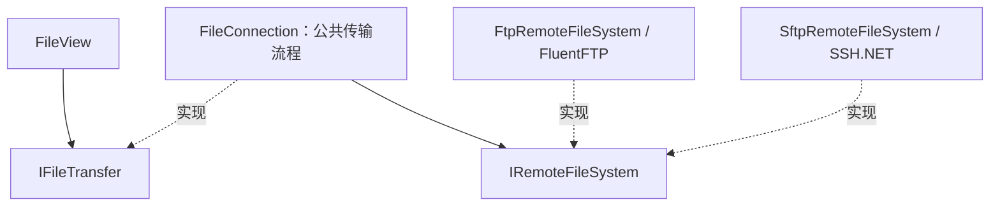

# 文件传输接口与扩展约定

本文档维护文件传输模块当前的接口与实现约定。目录、文件名和会话存储格式保持兼容。阶段状态和后续计划统一见[技术方案第 8 节](TECHNICAL-PLAN.md#8-分阶段实施)，开发过程及历史验证见[开发日志](DEVELOPMENT-LOG.md)。

## 调用边界

- Domain 中的 `IFileTransfer`、`IRemoteFileSystem`、`RemoteEntry` 和 `TransferProgress` 是公开的协议无关契约，包含连接状态、诊断事件、目录操作、上传和下载。
- Infrastructure 中的 `FileTransferFactory` 是当前应用的构造入口，装配协议适配器与 Application 用例。`FileView` 还接受注入的 `IFileTransfer`，并负责其释放。
- Application 中的 `FileConnection` 管理诊断、连接状态、进度累计、取消检查、临时文件和提交流程，目标为 `net8.0`，只依赖 Domain。其构造参数为协议、`IRemoteFileSystem` 和可选错误分类回调；默认 `ConnectionErrorPolicy` 只处理框架异常。
- Infrastructure 中的 FTP/SFTP 适配器实现 `IRemoteFileSystem`，各自处理连接、列表映射、文件流、覆盖提交和协议资源释放。工厂注入包含 SSH.NET 异常识别的 `DiagnosticClassifier`，共享 SSH 认证与主机密钥配置由 `SshClientSupport` 提供；适配器不依赖 UI 中的终端类。
- Infrastructure 目标仍为 `net8.0-windows`，DPAPI 已迁入 Windows 平台项目并经 `ISecretProtector` 注入；传输用例可脱离 Windows 构建和检查，整个协议适配项目尚未迁为跨平台目标。
- FileView 通过 Application 的 `IFilePicker` 选择本地上传来源/下载目标；默认 `WindowsFilePicker` 位于独立的 Windows Forms 平台项目。取消选择不启动传输，上传仍取本地文件名组合远程路径，下载保留建议文件名清理及本地覆盖确认，详见 [ADR 0006](adr/0006-windows-file-picker.md)。
- 工厂显式支持 FTP/SFTP；其他协议会被拒绝，避免把错误配置当成 FTP 连接。

## 契约与资源约定

1. 所有连接、列表、属性查询、文件流读写、目录操作和远程提交均使用依赖库的异步 API。单条连接由异步门闩串行化；界面不再通过 `Task.Run` 包装同步网络操作。
2. 每次操作都需要显式 `CancellationToken` 和正数超时。超时作用于排队等待、网络请求和复制过程；超时会取消底层请求并以 `TimeoutException`/稳定 Timeout 错误呈现。清理远端临时文件另有 5 秒尽力清理上限。
3. `TransferProgress` 提供方向、累计字节数和可选总字节数。报告按首块、100ms/4MiB 间隔及最终块节流；`Progress<T>` 会将界面更新投递回 UI 线程。
4. 复制使用 `ReadAsync`、`WriteAsync` 和 `FlushAsync`，流以异步释放关闭。取消会传递到连接、协议命令、流读写和本地文件操作；页面/应用关闭先取消当前请求，并等待操作退出及连接释放。
5. 下载写入目标目录下的唯一 `.part` 文件，流关闭且未取消后才替换本地目标。上传写入唯一远端 `.part` 文件，收到 FTP 最终确认/关闭 SFTP 流且未取消后才执行提交。失败或取消会尽力清理临时文件，并保留原目标。
6. FTP 覆盖使用服务器端覆盖移动。SSH.NET 2026.0 的取消令牌重命名 API不提供 POSIX 覆盖选项，因此 SFTP 将旧目标重命名到 `.bak`，再把临时文件重命名为目标；新文件重命名失败时尝试恢复旧目标。此方案保留数据恢复机会，但替换期间目标路径可能短暂不存在；断线或服务器故障可能留下 `.part`/`.bak`。
7. 删除目录只接受空目录。重命名前检查目标是否存在；外部客户端并发改名仍可能造成竞态，不提供跨客户端事务保证。
8. 连接阶段及每项操作均拒绝已关闭连接。重复连接已建立的连接不会重复创建客户端；异步释放幂等，并等待当前操作退出。连接失败会释放协议资源，允许调用方显式重试。
9. 诊断包含稳定错误码、阶段和操作编号，公共层诊断消息不包含主机、路径、密码或原始异常文本。异常仍传回调用方，由展示层负责安全呈现。

## 增加协议或替换客户端库

- 新增独立的 `IRemoteFileSystem` 实现，在其中转换厂商类型及异常、处理认证与资源释放。
- 在 `RemoteFileSystemFactory` 中显式注册协议；同时补齐会话配置与校验。共享流程不增加按协议判断的分支。
- 不能满足当前语义的协议需先设计能力契约，例如对象存储的目录和重命名语义，不应伪造文件系统能力。
- 补充适配器的本机协议检查，至少覆盖 Unicode 路径、上传下载、覆盖、取消清理、目标冲突和目录删除。
- 公共策略通过公开的用例构造函数注入内存适配器检查，可不启动服务器。Windows 检查通过 `InternalsVisibleTo` 核验内部适配器选择；产品传输接口不暴露厂商客户端。

## 验证入口

`tests/Shared/FileTransferPolicyChecks.cs` 与内存适配器由两个检查项目共用，验证公共策略、取消、超时、失败清理、状态与诊断。`PortHarbor.Application.Checks` 仅引用 Application，可独立验证这些用例；`PortHarbor.Checks/FileTransferChecks.cs` 另行核验工厂和 WinForms 接线。后者 `Program.cs` 的协议集成入口通过工厂获得 `IFileTransfer`，执行真实本机 FTP/SFTP 操作。运行方式见 README 的“验证”。
