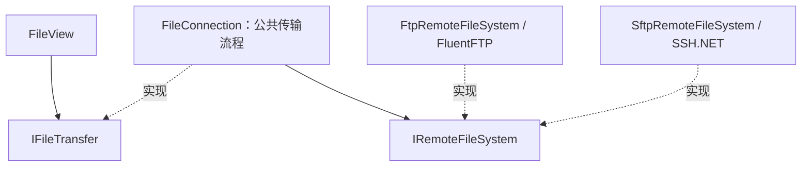

# 文件传输接口与扩展约定

本文档维护文件传输模块当前的接口与实现约定。目录、文件名和会话存储格式保持兼容。阶段状态和后续计划统一见[技术方案第 8 节](TECHNICAL-PLAN.md#8-分阶段实施)，开发过程及历史验证见[开发日志](DEVELOPMENT-LOG.md)。

## 调用边界

- `IFileTransfer` 与 `RemoteEntry` 是界面使用的协议无关契约，包含连接状态、诊断事件、目录操作、上传和下载。
- `FileTransferFactory` 是当前应用的构造入口。`FileView` 还接受注入的 `IFileTransfer`，并负责其释放。
- `FileConnection` 管理诊断、连接状态、进度累计、取消检查、临时文件和提交流程。它不引用 FluentFTP 或 SSH.NET。
- 内部 `IRemoteFileSystem` 隔离厂商客户端。FTP 与 SFTP 各自处理连接、列表映射、文件流、覆盖提交和协议资源释放。
- 工厂显式支持 FTP/SFTP；其他协议会被拒绝，避免把错误配置当成 FTP 连接。

## 契约与资源约定

1. 当前操作是同步的；调用方必须串行调用，界面仍通过 `Task.Run` 调度。不要把同步签名解释为已经支持原生异步网络 I/O。
2. 进度回调表示本次传输累计字节数。回调可能发生在工作线程，界面必须自行切换到 UI 线程。
3. 取消在数据块之间检查；预先取消的操作不会打开远程流。阻塞中的连接、目录操作或流读写仍需等待协议超时。
4. 下载写入目标目录下的独立 `.part` 文件，关闭流且确认未取消后才替换本地目标。
5. 上传写入远程 `.part` 文件，关闭流且确认未取消后调用适配器提交。清理临时文件失败不会覆盖原始传输错误。
6. SFTP 优先使用 POSIX 覆盖；服务器不支持时先暂存旧文件，再提交新文件，失败时尝试恢复。FTP 使用服务器的覆盖移动行为。断线可能遗留 `.part` 或 `.bak`，服务器间的原子性不能统一保证。
7. 删除目录只接受空目录。重命名前检查目标是否存在；外部客户端并发改名仍可能造成竞态，不提供跨客户端事务保证。
8. 未连接或已释放时拒绝文件操作。重复连接已建立的连接不会重复创建客户端；重复释放不会重复关闭。连接失败会释放资源，允许调用方显式重试。
9. 诊断包含稳定错误码、阶段和操作编号，公共层的诊断消息不包含主机、路径、密码或原始异常文本。异常仍传回调用方，由展示层负责安全呈现。

## 增加协议或替换客户端库

- 新增独立的 `IRemoteFileSystem` 实现，在其中转换厂商类型及异常、处理认证与资源释放。
- 在 `RemoteFileSystemFactory` 中显式注册协议；同时补齐会话配置与校验。共享流程不增加按协议判断的分支。
- 不能满足当前语义的协议需先设计能力契约，例如对象存储的目录和重命名语义，不应伪造文件系统能力。
- 补充适配器的本机协议检查，至少覆盖 Unicode 路径、上传下载、覆盖、取消清理、目标冲突和目录删除。
- 公共策略通过内存适配器检查，可不启动服务器。测试程序集通过 `InternalsVisibleTo` 使用内部测试接缝；产品接口不暴露厂商客户端。

## 验证入口

`tests/PortHarbor.Checks/FileTransferChecks.cs` 验证公共策略、取消、失败清理、状态与诊断；`Program.cs` 的协议集成入口通过工厂获得 `IFileTransfer`，执行真实本机 FTP/SFTP 操作。运行方式见 README 的“验证”。
