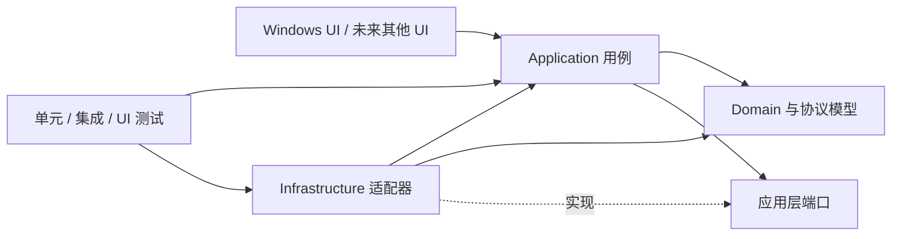

# PortHarbor 技术方案

版本：0.1.0 基线
状态：技术主线收尾；产品 P01–P10 已实现，P10 干净 Windows 发行验收待补（技术进度见第 8 节，产品计划见第 13 节）
范围：工程结构、诊断能力、平台与架构迁移，以及当前 Windows 版本的体验、界面和功能规划

## 文档分工与维护

| 文档 | 维护内容 | 更新时机 |
| --- | --- | --- |
| [文档入口](README.md) | GitHub 阅读顺序、当前快照、ADR 索引和上传前检查 | 文档结构或上传注意事项变化时 |
| 本文档 | 总体架构、路线图及验收条件；第 8 节维护技术进度，第 13 节维护产品计划 | 任务或阶段完成、计划调整时 |
| [开发与版本摘要](DEVELOPMENT-LOG.md) | 公开里程碑、重要验证结果、遗留边界及对应模块文档 | 重要交付时更新；完整逐轮流水和交接快照保存在 Git 忽略的本地归档 |
| [文件传输约定](FILE-TRANSFER.md) | 文件传输模块当前的接口、资源所有权、取消和覆盖语义及扩展规则 | 模块契约或实现边界变化时 |
| [终端会话约定](TERMINAL-SESSIONS.md) | 终端端口、启动/关闭所有权、输入顺序及适配器中止语义 | 终端契约或生命周期变化时 |

[README](../README.md) 负责功能介绍、运行、构建与验证命令。模块文档链接到本方案查看进度，不另行维护路线图；开发日志中的“下一步”是当时的记录，当前安排以本文档为准。历史验证结果不代表本次重新执行过检查。

## 1. 目标与原则

PortHarbor 当前是 Windows 桌面连接工作台，提供 SSH、Telnet、RDP、FTP、SFTP、串口和本地 Shell，并包含会话管理、文件传输和基础 ANSI/VT 终端。方案以现有产品为起点，先改善可维护性和可诊断性，再为替换 UI、存储和操作系统实现留出边界。

设计原则：

1. Windows 继续作为当前正式支持平台；跨平台准备不等于提前承诺各平台功能完全一致。
2. 通过依赖方向和小型接口隔离变化，不为尚不存在的第三方扩展场景建立插件系统。
3. 先把领域逻辑、协议状态机和数据契约从 UI/操作系统中分离，再考虑替换技术栈。
4. 每个阶段都保持可构建、可测试、可回退；迁移以适配器和兼容性测试逐步完成。
5. 可诊断性和安全性属于功能要求：错误应可定位，日志不得泄露凭据、私钥或会话敏感内容。

## 2. 当前基线

| 领域 | 当前情况 | 对规划的影响 |
| --- | --- | --- |
| 桌面 UI | `PortHarbor` 是 `net8.0-windows` WinForms 组合根；`MainForm` 负责导航、视图和平台服务装配 | 保留 WinForms 作为当前壳；连接生命周期、存储和平台调用通过 Application/平台端口进入 |
| 会话与存储 | Application 提供会话、配置及导入导出策略；Infrastructure 负责 JSON/INI、schema v1/v2、备份、迁移和主机信任 | 保持 v1/v2 与安装/便携配置兼容，导入通过最新快照单次保存和失败回滚 |
| 终端会话 | Application 的 `TerminalConnection` 管理统一终端生命周期、I/O 队列、取消和资源释放；SSH/Telnet 在 Infrastructure，Shell/Serial/ConPTY 在 Windows 平台 | 继续完善剩余协议实机验证和平台边界 |
| 文件传输 | Application 的 `FileConnection` 管理取消、超时、临时文件和覆盖策略；FTP/SFTP 由 Infrastructure 适配 | 当前契约见 [文件传输约定](FILE-TRANSFER.md)，实现保持异步操作和失败清理 |
| 终端显示 | Domain 的 `TerminalScreen` 保存解析状态，WinForms `TerminalView` 负责绘制 | 保持解析器无 UI 依赖，后续再评估成熟终端引擎 |
| Windows 边界 | DPAPI、mstsc、能力、路径和 ConPTY 位于 Windows 平台项目；文件对话框位于独立的 Windows Forms 平台项目 | 保留现有用户交互与数据兼容，Application 文件选择端口不依赖 UI |
| 依赖与构建 | 锁定 NuGet；`-P10` 生成自包含单文件便携及 Inno Setup 安装向导；原框架依赖 ZIP 基线入口保留 | 体验产物集中 releases，验收与缓存单列；发布使用暂存和原子替换 |
| 测试 | Application 检查、核心 Windows 检查、WinForms/ConPTY 检查和本机 Python 协议回环均由 `PortHarbor.Checks` 分层入口执行 | 继续保持快速检查、Windows 系统检查、协议端到端和发布冒烟分层 |
| 工程自动化 | 已有 Windows CI 工作流和分层检查入口；WinForms 界面、应用用例和平台/协议适配器已分项目 | 继续补齐工程基线验收及未完成的业务边界 |

当前依据来自 [README](../README.md)、[开发日志](DEVELOPMENT-LOG.md)、[PortHarbor.csproj](../src/PortHarbor/PortHarbor.csproj)、[build.ps1](../build.ps1)、Domain/Application/Infrastructure/Platform.Windows 项目及 `MainForm.cs`。早期单体文件名只保留在历史日志中，不作为当前源码路径；方案中的完成状态以当前工作区和验证报告为准。

### UI 与双版本配置增量（2026-10-23）

- [x] 终端使用已安装等宽字体回退，字体及 DPI 变化重算字符格。
- [x] 分类树增加文件夹、终端、文件传输和 RDP 图标，支持多层嵌套与搜索保留父路径。
- [x] 菜单分为文件、会话、窗口、设置和帮助，下拉管理操作。
- [x] 安装版用户目录 JSON / 便携版程序旁 INI；便携密码库由主密码保护，安装版保留 DPAPI。
- [x] 构建同时输出两版目录包，包含运行环境为独立选项。
- [x] 安装向导、升级与卸载流程已实现（P10；干净 Windows 交付验收待补，见发行说明）。

本增量完成日期：2026-10-23；提交：当前工作区，待提交。

2026-10-23 终端交互增量：主密码命名、跳过解锁、滚动条、可选左键复制、可选右键粘贴、字体和配色菜单已实现，当时设置持久化与 SSH 交互式认证尚未完成。后续 P01 已实现终端偏好持久化，P09 交互式认证现已完成本机自动验收；最新产品状态见第 13.5 节。P10 已实现正式安装向导，干净 Windows 验收仍待补。本增量的当前实现分布在 `src/PortHarbor/MainForm.cs`、`SessionEditor.cs`、Domain/Application/Infrastructure 和 Windows 平台项目中；历史单体文件名只保留在开发日志中。基线表中此前仅 JSON、DPAPI 和单一框架包的描述以本增量为准；阶段 0–4 的整体状态仍按各自验收条件判断。

## 3. 目标依赖结构

依赖只朝向较稳定的领域和用例；UI 与基础设施都实现应用层定义的边界，不互相引用。



建议逐步形成以下项目边界；不需要在第一阶段一次建齐：

```text
src/
  PortHarbor.Domain/             会话、协议配置、校验、传输状态和无 UI 的终端模型
  PortHarbor.Application/        创建/编辑/连接/断开/导入导出/传输等用例和端口
  PortHarbor.Infrastructure/     JSON、SSH.NET、FluentFTP、串口和日志实现
  PortHarbor.Platform.Windows/   DPAPI、ConPTY、mstsc、能力与路径等实现
  PortHarbor.Platform.Windows.Forms/ Windows Forms 文件选择器适配
  PortHarbor.App.Windows/        WinForms 组合根、窗体、控件和 UI 线程适配
tests/
  PortHarbor.UnitTests/          不启动窗体、不访问外网的快速测试
  PortHarbor.IntegrationTests/   loopback 协议和存储适配测试
  PortHarbor.WindowsChecks/       WinForms、DPAPI、ConPTY 等 Windows 专属检查
```

依赖规则：Domain 不引用 WinForms、平台 P/Invoke、存储实现或协议厂商库；Application 只依赖 Domain 和端口；平台及协议适配器依赖端口并返回统一结果；UI 不直接构造协议客户端或操作配置文件。组合根负责把实现装配起来。将来换 UI 时保留 Domain/Application/协议规则；换操作系统时替换 Windows 平台项目，并逐项评估功能能力。

## 4. 核心边界和契约

### 4.1 会话与协议配置

- 运行侧已拆为公共 `SessionMetadata` 和七种不可变协议配置，工厂向适配器传入对应类型；`Session` 继续作为兼容编辑/存储 DTO，保留旧 JSON/INI 和未启用协议字段，详见 [ADR 0010](adr/0010-typed-protocol-configurations.md)。
- 在 UI 和持久化入口进行输入校验；领域模型提供无控件依赖的规则和清晰错误。协议端口、主机名、串口参数、RDP 地址等规则必须有边界测试。
- 为数据契约保留 `SchemaVersion`，用有序迁移 `v1 -> v2 -> ...` 升级配置；迁移失败时保留原文件并报告旧版/新版路径、版本和修复建议。导入导出使用单独 DTO，默认不包含密码和 SSH 主机信任记录。当前规则与存储事务见[会话配置导入导出约定](CONFIGURATION-TRANSFER.md)及 [ADR 0007](adr/0007-configuration-transfer-policy.md)。
- 保持已发布用户数据兼容。改字段名、协议编码或凭据格式前，先增加迁移测试和旧样本 fixture；不得把当前的用户级 DPAPI 密文当成可移植凭据。

### 4.2 连接端口

按能力定义窄接口，而不是一个含所有协议可选方法的万能连接接口：

- `ITerminalConnector`：按终端协议创建 `ITerminalSession`，提供 `ConnectAsync`、`ReadAsync`、`WriteAsync`、`ResizeAsync` 和 `CloseAsync`。
- `IFileTransferClient`：列目录、上传、下载、创建目录、重命名和删除；进度和取消使用标准回调/令牌。
- `IRemoteDesktopLauncher`：接受经校验的 RDP 选项并返回启动结果；不把 RDP 窗口生命周期伪装成嵌入式会话。
- `ISerialPortProvider`、`ILocalShellLauncher`：暴露平台能力、设备列表和启动/错误信息。
- `IHostKeyTrust`：执行 SSH 首次信任、已知密钥匹配和变更拒绝。确认回调由 UI 注入，存储适配器只保存用户确认的指纹。

接口只表达本产品需要的能力。SSH 和 SFTP 可以共享主机身份验证实现，但不必共享不同的终端/文件操作模型。每个网络 I/O 都应接受取消令牌和连接/操作超时；对不支持可中断取消的第三方 API，适配器必须说明行为并通过关闭底层资源解除阻塞。

### 4.3 平台服务

- `ISecretProtector`：保护/解密用户机密；Windows 初始实现使用 DPAPI。跨设备同步需要另行设计密钥管理和用户授权，不得通过简单换成固定应用密钥实现。
- `ILocalShellLauncher`：Windows 使用 ConPTY；其他平台可选其原生 PTY 实现。会话 Shell 运行的是本机进程，必须在 UI 中清楚标识并受用户授权。
- `IRemoteDesktopLauncher`：Windows 可使用 mstsc；其他平台若无等价系统客户端则显示能力不支持或提供明确配置的外部客户端。
- `IPlatformCapabilities`：报告可用能力及原因，例如 DPAPI、串口、PTY、RDP 外部客户端；UI 据此禁用或解释不可用功能。
- `IAppDataPaths`：提供配置、缓存、日志和临时文件目录。路径策略和权限在各平台实现，不让业务代码直接依赖 `LocalApplicationData`、`explorer.exe` 或平台目录格式。
- `IFilePicker`：同步单文件打开/保存，传递过滤器、建议文件名与选中路径，取消返回 `null`；Windows Forms 适配器持有模态 owner，业务端口不暴露窗口类型。

平台能力不是二元的“可移植/不可移植”。每项功能应记录支持状态、降级状态和验证平台。文件会话可以跨平台迁移，DPAPI 密码密文、Windows Shell 命令和 mstsc 参数则不能假设可迁移。

## 5. 工程规范

### 代码和模块

- 保持 Nullable 开启；启用统一格式化、编译器警告和 .NET 分析器基线。新警告需在提交中解决或说明豁免，不随意关闭全局规则。
- 一个类型只承担一个主要变化原因；窗体负责呈现和用户交互，不负责协议握手、JSON 迁移或重试策略。
- 异步 I/O 使用 `Async` 命名、`CancellationToken` 和显式超时；避免 `.Result`、同步网络调用和吞异常。UI 控件更新必须经 UI 调度器完成。
- 资源实现 `IDisposable`/`IAsyncDisposable`，连接关闭应幂等；生命周期测试覆盖连接失败、取消、远端断开、关闭标签和应用退出。
- 协议实现保持厂商库封装在 Infrastructure。领域层不暴露 SSH.NET、FluentFTP、WinForms 控件或 `SafeHandle` 类型。
- 新的跨层决策记录在 `docs/adr/NNNN-short-title.md`，写明背景、选项、决策、影响和复审条件。需要新增依赖时说明它解决的问题、维护风险、许可和替代方案。

### 数据、安全和发布

- JSON 配置保存继续采用临时文件、冲刷、原子替换和备份；并发写入需有明确单实例策略，不能把进程内锁误当跨进程锁。
- 日志采用操作/会话编号、协议、状态、阶段、时长、超时参数、错误码、字节/解码计数和恢复状态等结构化字段。始终排除密码、私钥、密文、端点、路径、终端内容和文件数据；大小、保留天数及归档数可配置。
- 给用户显示安全错误和建议；异常分类依据类型，日志保存稳定错误码和阶段。为避免泄漏端点/路径，不记录原始异常类型名、消息或内部堆栈；此取舍见 [ADR 0009](adr/0009-local-diagnostic-log.md)。
- 网络操作设置连接与读写超时；文件传输报告方向、字节数、临时文件/恢复状态。重试必须限定在明确幂等的操作，不能自动重放 Shell 命令或不确定是否完成的远端写入。
- NuGet 继续使用锁文件；升级依赖需运行单元、协议集成和安全相关测试并更新第三方许可清单。CI 使用无凭据的本地 fixture，不连接真实用户设备。
- 发布在临时 staging 目录完成构建和冒烟测试，成功后才替换最终 ZIP；失败时保留上一版产物。发布记录包含版本、提交号、SDK/runtime、目标 RID、依赖锁和验证摘要。

2026-10-30 落地：`.editorconfig`、固定 .NET 8 分析器与警告即错误；增量 C# 格式门禁；应用入口持有配置目录独占 lease；两个发布入口记录构建身份，诊断包增加安全构建字段；RDP 工作区按锁、PID/启动时间保守回收。[ADR 0021](adr/0021-technical-baseline-completion.md)说明边界；真实环境操作见[E01–E12](REAL-ENVIRONMENT-ACCEPTANCE.md)。

## 6. 易于排查的运行诊断

建立统一的连接生命周期状态：`Created -> Connecting -> Connected -> Closing -> Closed`，失败时附带稳定 `ErrorCode`、阶段、可重试性和安全的用户提示。禁止只把任意异常的 `Message` 直接当成诊断协议。

每次连接生成 `operationId`，并贯穿应用用例、协议适配器、文件传输和 UI 状态。终端输出与诊断日志分开；诊断包 schema 2 包含版本、平台、安全构建身份和最多 500 条安全事件，不收集用户配置摘要。帮助菜单提供固定快照预览及本地导出，由用户自行决定是否分享。

最小排查流程应能回答：

1. 当前版本、提交、运行时和平台能力是什么？
2. 操作停在校验、解析、TCP、认证、主机信任、PTY、目录读取还是文件替换哪个阶段？
3. 是本机能力缺失、远端拒绝、用户取消、超时，还是程序内部错误？
4. 若连接成功但无输出，字节是否收到、解码字符数是否变化、终端解析状态是否变化？默认只记录计数，不记录终端内容。
5. 文件任务失败后，目标文件、远端 `.part`/`.bak` 和最后已确认字节数分别是什么？

当前通过自有 `IDiagnosticLog` 窄端口写本地轮转文件，设置位于配置目录下 `logs/`；没有新增日志框架或在线遥测。端点及敏感内容始终排除，详见[诊断约定](DIAGNOSTICS.md)。

## 7. 测试与 CI

### 测试层级

| 层级 | 覆盖内容 | 环境要求 | 运行频率 |
| --- | --- | --- | --- |
| Domain 单元测试 | 会话校验、端口默认值、数据迁移、终端状态机、Telnet 分片/编码、错误分类 | 不启动 UI，不需要网络 | 每次提交 |
| Application 测试 | 连接状态转换、取消、导入导出、主机信任决策、重试策略 | 依赖替身/假适配器 | 每次提交 |
| Infrastructure 集成测试 | SSH/SFTP/FTP/Telnet loopback、JSON 原子替换、凭据适配 | 本机服务；Windows 专属凭据测试在 Windows Runner | PR 和夜间任务 |
| Windows UI/系统测试 | WinForms 渲染、ConPTY 输入输出、DPAPI、RDP 配置生成 | Windows x64 | PR 冒烟及发布 |
| 发布冒烟 | 解压 portable/framework ZIP，验证入口、依赖、许可和启动/退出 | 干净 Windows 虚拟机 | 发布候选 |

- 快速测试和系统集成测试使用不同项目/标签，测试失败应返回非零退出码并输出机器可读 JSON/JUnit 报告。
- 为当前 `PortHarbor.Checks` 的自定义检查建立清单，将纯逻辑逐步迁入标准测试框架；Windows UI/ConPTY 检查继续保留为单独入口。
- 固定本地测试账号、随机临时目录和 loopback 绑定；每个测试用例负责清理进程、端口、临时文件。测试不能使用生产配置目录。
- 加入 Windows CI：格式检查、锁定依赖恢复、Release build、快速测试和现有 loopback 集成。2026-10-30 已为独立 net8.0 的 Domain/Application 增加 Linux/macOS 核心测试矩阵，并为 P10 增加独立发行验收 job；新 job 待推送执行。不把 UI/串口/RDP 项目放入非 Windows 矩阵。
- 失败产物只保留脱敏日志、报告和必要的屏幕截图；不要上传凭据、用户配置或终端输出。

## 8. 分阶段实施

进度核对日期：2026-10-30。依据当前源码、构建脚本、CI 工作流及开发日志中的验证记录。

| 阶段 | 状态 | 清单完成项 | 当前结论 |
| --- | --- | --- | --- |
| 0：工程基线 | 实现及本机验收完成 | 12/12 | T6 标准测试、TRX 与纯核心覆盖率已接入；新增 CI/P10 job 待推送运行，本批提交后再做干净 checkout |
| 1：诊断与稳健性 | 软件收尾完成，实机待验收 | 16/17 | 连接/写入超时、后台生命周期、本地日志设置及可审阅导出已实现；物理断网和串口阻塞待验收 |
| 2：稳定内核 | 实现及本机验收完成 | 12/12 | 纯逻辑审计及七协议运行配置类型化完成，旧 JSON/INI 和凭据关联保持兼容 |
| 3：协议与平台隔离 | 实现已落地，验收未收齐 | 10/10 | 协议、平台端口与适配器已接入，真实设备/远程登录验收仍待完成 |
| 4：新平台或 UI | 未开始（按需求启动） | 0/4 | 尚未选择新平台或新 UI 框架；不阻止改善现有 WinForms |

维护规则：`[x]` 仅表示该子任务已完成，`[ ]` 表示未完成或尚未验证。部分完成的任务应拆成可独立核验的子项。每次开发结束同步更新清单并追加开发日志；只有全部任务及完成条件均有验证依据，才将阶段标为“已完成”，填写完成日期、对应提交和开发日志链接。阶段可以交叉实施，提前完成某个子项不代表整个阶段完成。

### 当前还差多少，以及何时转向产品开发

阶段 0–3 当前共 **51 个清单项，50 项完成，1 项待环境验收**。按条目约 98%，仅为清单统计，不代表工时或源码覆盖率。T6 已完成标准测试接入，主要软件欠项已落实；剩余清单项为实际断网/串口等故障专项，阶段 3 仍需真实设备/服务器互通。所有实机项目及操作集中在[实机验收手册](REAL-ENVIRONMENT-ACCEPTANCE.md) E01–E12；不是只有一次测试，也不能据清单数声称全部验收完成。阶段 4 的 4 项均未启动，按新平台或新 UI 框架需求另行决定。

用户要求逐一开发的 **T1–T5 软件范围已完成**；T2 实机专项仍明确保留，不用本机回环代替。交付记录如下：

| 顺序 | 交付包 | 完成时能确认什么 | 对应清单 |
| --- | --- | --- | --- |
| T1 | 发布故障与回滚收尾 | 已完成：四种故障注入及成功替换，回滚受阻保留备份与恢复目录；接入 CI | 阶段 0 发布故障注入 |
| T2 | 剩余网络取消与故障覆盖 | 软件范围完成：实际解析失败、静默握手、同步 SSH 通道超时及写入期限；真实断网/串口阻塞待环境验收 | 阶段 1 同步路径、剩余故障场景 |
| T3 | 后台任务与剩余纯逻辑审计 | 已完成：UI 任务观察、ConPTY 等待退出、RDP 观察任务清理；分类校验/会话筛选迁入 Application | 阶段 1 后台任务、阶段 2 其余纯逻辑 |
| T4 | 本地诊断闭环 | 已完成：安全 JSONL、实际时长/计数、轮转/保留设置、固定预览及本地导出界面 | 阶段 1 两项诊断欠项 |
| T5 | 协议配置类型化 | 已完成：七种不可变运行配置进入适配器，旧 DTO/JSON/INI 和凭据关联兼容回归 | 阶段 2 协议配置欠项 |
| T6 | 标准测试框架迁移 | 已完成：net8.0 NUnit，15 个独立测试组、TRX、Domain/Application 行/分支覆盖率；保留原 Windows/协议/UI/ConPTY 入口 | 阶段 0 测试框架欠项，见[测试清单](TESTING.md) |

另有需要环境的验收：真实串口与阻塞、真实 RDP 登录、FTPS、私钥登录、多种服务器互通及另一台 Windows 机器复现。无法用 loopback 报告将其勾为完成；原 Temp 克隆 FTP 550 的原因也仍未确认。

**现有 Windows UI、功能和体验开发已推进至 P10。**T1–T6 软件收尾及 P01–P09 本机回归已完成；P10 实现自包含单文件便携、安装向导与升级/卸载，干净 Windows 发行验收待补，见[发行说明](DISTRIBUTION.md)。本轮同时落实多进程配置写保护、格式/分析器基线、构建追溯及 RDP 遗留清理策略，见 [ADR 0021](adr/0021-technical-baseline-completion.md)。后续以实机专项和产品反馈为主；更换框架或支持新系统才进入阶段 4。

### 阶段 0：建立工程基线

状态：实现及本机验收完成；完成日期：2026-10-30；本批提交：待提交。新增 CI job 待推送后执行，当前增量的独立干净 checkout 待提交后验收。

- [x] 将验证拆为核心、Windows、协议集成和 UI/ConPTY 入口，提供 JSON 结果报告。
- [x] 加入 Windows CI，执行恢复、Release 构建及上述检查，上传结果报告。
- [x] 使用 NuGet 依赖锁文件。
- [x] 加入自动差异空白检查及强制锁定模式恢复验证。
- [x] 将发行包启动冒烟纳入发布流程；已有 `tests/build-rollback.ps1` 验证失败后保留旧产物。
- [x] 在 Windows 本机独立干净 checkout、空构建/依赖缓存下完成锁定恢复与完整扩展基线；验收提交 `e110c4e`，共 568 项检查及四项冒烟通过。
- [x] 补齐发布失败故障注入：替换前失败、部分目标替换后失败、旧 ZIP 被占用时均核验旧产物；另注入新目标被占用导致回滚不完整，要求保留旧备份与恢复 staging，不得静默删除。
- [x] 按第 7 节建立[纯逻辑迁移清单](TESTING.md)，接入独立 NUnit 标准测试、TRX、Domain/Application Cobertura 覆盖率；保留独立 Windows/协议/UI/ConPTY 入口。
- [x] 建立构建、测试耗时和覆盖范围基线；发布脚本生成 `engineering-baseline.json`，区分原检查计数与 Domain/Application 源码行/分支覆盖率；Windows/UI/适配器源码覆盖率未测量。
- [x] 发布脚本使用 staging，成功后替换产物，失败时尝试回滚。
- [x] 增加总体技术方案。
- [x] 增加 ADR 模板。

依据：[`windows-ci.yml`](../.github/workflows/windows-ci.yml)、[`build.ps1`](../build.ps1)、[`build-rollback.ps1`](../tests/build-rollback.ps1)、[`packages.lock.json`](../src/PortHarbor/packages.lock.json)、[`ADR 模板`](adr/0000-template.md)；基线报告为 `engineering-baseline.json`，干净 checkout 的提交、环境、结果及限制见[开发日志](DEVELOPMENT-LOG.md)中“独立干净 checkout 验收及协议失败日志归档”。本次仅完成同一台 Windows 机器上的独立克隆验收，另一台机器的复现和原 Temp 克隆 FTP 550 的根因仍待确认。

**完成条件：**干净 checkout 可按文档复现 build/test；PR 有自动结果；失败时能看到稳定测试名和机器可读报告；发布失败不删除旧 ZIP。

### 阶段 1：提高可诊断性与稳健性

状态：进行中；完成日期：待验收；完成提交：待验收。

- [x] 建立稳定错误码、连接阶段、状态、可重试性和 `operationId`，接入终端及文件连接诊断。
- [x] 增加安全诊断展示器，文件视图显示阶段及错误类别。
- [x] 建立 Application 内嵌诊断消息目录，将稳定错误码/阶段与中文提示分离；无 UI 的 DiagnosticPresenter 负责组合，覆盖完整性、未知枚举/语言回退、操作编号和全协议敏感信息隔离。
- [x] 统一终端及 RDP 的诊断展示，核验 SSH、Telnet、FTP、SFTP、Shell 和 RDP 的失败路径；串口实体设备及 FTPS 仍待实机验证。
- [x] 将文件传输契约及 FTP/SFTP 适配器改为原生异步，统一取消、超时和结构化进度，移除文件视图的同步调用包装。
- [x] 文件连接及终端启动/写入受配置期限约束；实际解析失败、静默 SSH 握手、同步 SSH 通道创建和写入阻塞有取消/超时回归；关闭中止并等待所属资源，不自动重试或重放。交互终端空闲读取不设固定超时。
- [x] 文件视图关闭标签及应用退出时取消并等待活动文件操作和传输连接释放。
- [x] 终端通过统一会话端口提供可等待关闭，标签和应用退出等待启动、输入任务及资源清理。
- [x] 完成其余 UI/后台生命周期审计：任务由 `BackgroundTask.Observe` 观察，未报告错误提供安全兜底；关闭等待文件/终端，ConPTY 等待进程观察器，RDP 停止观察及删除临时配置但不关闭外部窗口。尽力清理和已报告错误的 catch 保留明确语义，审计表见开发日志。
- [x] 增加连接失败/关闭诊断、安全展示脱敏、文件传输取消清理与目标冲突检查。
- [x] 增加终端启动中取消、晚启动返回、阻塞写入关闭竞态，以及真实 SSH 握手/Telnet 读取阻塞取消检查。
- [x] 补齐 SSH/Telnet/FTP/SFTP 拒绝连接、FTP 错误密码、SSH 连接丢失与正常 Shell 退出、Telnet reset 与正常 EOF 的本机协议检查；修复 SSH 掉线后阻塞读取和 FTP 错误连接阶段，保留关闭清理与安全提示。
- [x] 补齐 FTP/SFTP 数据复制阶段断线的旧目标保护、下载暂存清理、原阶段诊断及关闭期限检查；下载增加已知长度和最终协议确认门禁，FTP 最终拒绝确认不得覆盖旧文件，确认等待中关闭可取消。
- [x] 补齐 SFTP 覆盖提交/备份恢复期间断线、确认丢失、恢复拒绝和无响应检查；恢复及成功后的备份清理各限时 5 秒，保留原始结果，核验旧文件/备份/暂存的实际状态与新连接显式恢复。
- [ ] 完成真实物理断网/黑洞网络、串口阻塞及设备/服务器故障专项；本轮已通过随机 `.invalid` 实际解析失败、静默 SSH 对端、同步通道无响应、写入阻塞和 ConPTY/RDP 进程生命周期检查，本机替身不能代表上述环境验收。
- [x] 接入本地 JSONL 安全字段日志：操作/会话编号、状态、阶段、错误码、实际耗时/计数和恢复状态；设置界面可保存启用、大小、保留天数及归档数量，写入失败不影响连接。
- [x] 帮助菜单提供固定诊断包预览和选择路径导出，含 schema、版本、运行时、平台及最多 500 条安全事件，导出内容等于预览；不含凭据、端点、路径、终端内容或文件数据，不自动分享。

依据：[`DiagnosticClassifier.cs`](../src/PortHarbor.Infrastructure/DiagnosticClassifier.cs)、[`DiagnosticPresenter.cs`](../src/PortHarbor.Application/DiagnosticPresenter.cs)、[`消息目录`](../src/PortHarbor.Application/DiagnosticMessageCatalog.cs)、[`资源`](../src/PortHarbor.Application/Resources/DiagnosticMessages.resx)、[`ConnectionStatusLabel.cs`](../src/PortHarbor/ConnectionStatusLabel.cs)、[诊断消息约定](DIAGNOSTICS.md)、[ADR 0008](adr/0008-diagnostic-message-catalog.md)、终端/RDP/文件连接实现及[开发日志](DEVELOPMENT-LOG.md)。目录回归报告位于 ignored `artifacts/diagnostic-messages/`；其余未勾选任务仍需单独验收。

**完成条件：**每个连接失败都能定位操作阶段和错误类别；关闭页面能及时解除后台 I/O；没有凭据或终端文本进入日志。

### 阶段 2：从单体中抽出稳定内核

状态：实现及本机验收完成；完成日期：2026-10-27；完成提交：`16c5fa2`（T1–T5 软件收尾，见开发日志）。

- [x] 新建 Domain 项目，迁入 `Session`/协议配置校验、协议枚举、连接诊断契约和 Telnet codec；Domain 独立目标为 `net8.0`，不引用 WinForms 或协议厂商库。
- [x] 将文件传输数据记录、进度契约和 `IFileTransfer`/`IRemoteFileSystem` 端口迁入 Domain；FTP/SFTP 工厂及实现仍留在基础设施侧。
- [x] 将终端屏幕状态模型 `TerminalScreen` 和 `Cell` 迁入 Domain，保留基础颜色值类型，不依赖 WinForms 或 GDI 渲染。
- [x] 完成纯逻辑审计，将分类路径校验、会话库筛选/排序与独立快照迁入 Application；导入导出、诊断呈现、连接编排已在 Application，协议校验/终端模型在 Domain。控件布局/绘图留在 UI，格式解析留在存储适配器。
- [x] 公共元数据与七种不可变协议运行配置分离，工厂、网络/Windows 终端、文件适配器及 RDP 消费对应类型；旧 `Session` 编辑/存储 DTO、JSON/INI 形状和未启用字段保留，七协议非默认字段及旧凭据关联回归通过。
- [x] 新建 Application 项目，迁入会话创建、编辑、删除和读取用例；定义 `ISessionRepository`，不引用 WinForms 或厂商库。
- [x] 定义配置仓储、密码库、主机信任端口及 `ConfigurationService`；界面、SSH 终端和 SFTP 适配器通过端口使用。
- [x] 将 `Store` 的 JSON/INI 格式读写、密码库及主机信任持久化拆入 `PortHarbor.Infrastructure`；适配器共享配置状态、写入锁及原子替换，项目目标 `net8.0-windows` 且不引用 WinForms。
- [x] 将 `FileConnection` 和共享超时策略迁入 Application，通过 `IRemoteFileSystem` 及错误分类回调隔离协议厂商；独立 `net8.0` 检查覆盖取消、临时文件、提交、超时及关闭竞态。
- [x] 定义 `ITerminalSession`/`ITerminalTransport`，将终端校验、连接生命周期、输入队列、UTF-8 解码、取消与关闭编排迁入 Application。
- [x] 将分类合并、新 ID 分配、导入/导出禁用密码保存和敏感字段排除迁入 Application；格式读写与最新快照下单次保存/回滚留在存储适配器，补齐真正 JSON/INI 交叉格式、并发与凭据关联检查。
- [x] 为会话 JSON v1/v2 和便携 INI 建立 fixture、迁移、凭据关联及失败回滚检查；先保持当前界面和用户数据目录不变。

验收依据：本轮独立 Application 175 项、核心 366 项通过，覆盖纯业务规则、连接超时、配置往返和旧凭据关联；平台/UI/协议及发布结果见[开发日志](DEVELOPMENT-LOG.md)。Domain/Application 可独立构建且无 UI/厂商依赖，Infrastructure 保留 Windows 目标以维持已支持平台，未将跨平台存储作为本轮范围。运行配置与旧 DTO 的兼容策略见 [ADR 0010](adr/0010-typed-protocol-configurations.md)。

**完成条件：**Domain/Application 可单独构建和测试；应用项目不需要引用 WinForms；旧配置在重构前后读取结果一致。

### 阶段 3：隔离协议和 Windows 实现

状态：实现已落地，真实设备/服务器验收未收齐；完成日期：待验收；完成提交：待验收。

- [x] 将 SSH/Telnet 终端拆为 Infrastructure 适配器，共用 Application 终端端口，移除 UI 对 SSH.NET 的直接包引用。
- [x] 建立 `PortHarbor.Platform.Windows`，分别迁入串口、本地 Shell 与 ConPTY 实现；共享流生命周期基类归入 Application，平台项目不引用 UI 或网络 Infrastructure。
- [x] 增加 `ISerialPortProvider`，通过平台实现提供串口设备与参数选项；UI 移除 System.IO.Ports 直接包引用及类型使用，保持旧配置字符串兼容。
- [x] 建立异步 `IFileTransfer`/`IRemoteFileSystem` 边界，拆分 FTP/SFTP 适配器；公共层管理超时、取消、临时文件和结构化进度，UI 保留覆盖确认。
- [x] 将文件传输用例及 FTP/SFTP 适配器迁入独立 Application/Infrastructure 项目；共享 SSH 配置与厂商错误分类位于 Infrastructure，维持异步契约和既有回归结果。
- [x] 定义 `ISecretProtector`，将 DPAPI 移入 Windows 平台项目并注入存储；保留安装版、便携版及旧凭据迁移格式，平台失败不得降级保护。
- [x] 定义 `IRemoteDesktopLauncher`，将 RDP 校验/配置/诊断迁入 Application，mstsc 与临时文件生命周期移入 Windows 平台项目。
- [x] 定义 `IAppDataPaths`，将安装/便携路径、旧 EasyConnect 迁移源和 RDP 临时目录解析移入 Windows 平台项目；存储适配器消费解析结果并拒绝配置文件越界路径。
- [x] 定义 `IFilePicker`，将会话导入导出及文件上传下载的打开/保存对话框迁入独立 `PortHarbor.Platform.Windows.Forms`；保留现有 owner、过滤器、默认文件名及取消/覆盖语义，既有平台库不增加 WinForms 依赖。
- [x] 在 UI 组合根注册 `IPlatformCapabilities` Windows 实现，编辑器禁用不可用连接但允许保存，连接入口在创建资源前显示原因并支持重新检查；帮助菜单展示包括 DPAPI 在内的能力概览。

依据：[`FileTransferContracts.cs`](../src/PortHarbor.Domain/FileTransferContracts.cs)、[`TerminalContracts.cs`](../src/PortHarbor.Application/TerminalContracts.cs)、[`平台服务端口`](../src/PortHarbor.Application/PlatformContracts.cs)、[`路径端口`](../src/PortHarbor.Application/AppDataPaths.cs)、[`文件选择端口`](../src/PortHarbor.Application/FilePicker.cs)、[`能力端口与连接策略`](../src/PortHarbor.Application/PlatformCapabilities.cs)、[`Windows 平台项目`](../src/PortHarbor.Platform.Windows/PortHarbor.Platform.Windows.csproj)、[文件传输约定](FILE-TRANSFER.md)、[终端会话约定](TERMINAL-SESSIONS.md)、[凭据与 RDP 决策](adr/0003-secret-protection-and-rdp.md)、[平台能力决策](adr/0004-platform-capabilities.md)、[路径决策](adr/0005-application-data-paths.md)、[文件选择决策](adr/0006-windows-file-picker.md)及开发日志。协议回环 26 项通过，DPAPI 迁移、RDP 清理、能力缺失/恢复、路径解析/迁移与文件选择接入已覆盖；真实 RDP 登录及串口仍需后续验收，系统文件对话框点击未纳入自动化。

**完成条件：**领域/用例项目没有 Win32 API 和协议厂商类型；各适配器单独可测；Windows 当前功能保持现有验收结果。

### 阶段 4：按实际需求选择新平台或新 UI

状态：未开始（按需求启动）；完成日期：待验收；完成提交：待验收。

- [ ] 先选一个有实际用户需求的平台和一组目标能力，不默认一次支持所有协议。
- [ ] 评估 UI 框架、PTY、串口、凭据库、RDP 外部客户端、打包/签名和可访问性；用短期技术验证确认生命周期和终端性能。
- [ ] 建立平台能力表和差异化测试。配置迁移优先保证非秘密会话数据；Windows DPAPI 密文不静默迁移或降级。
- [ ] 以独立 platform/UI 项目实现新壳；Windows WinForms 版本继续维护，直到新壳达到功能和发布验收标准。

验收依据：待需求确定后记录目标平台、能力清单、技术验证及发布验收结果。

**完成条件：**新平台的目标功能有自动化测试、打包安装路径、数据迁移说明和回退方案；支持矩阵如实列出尚不支持功能。

### 预览体验优化（2026-10-23）

状态：已完成本次实现与本机验收；完成日期：2026-10-23；对应提交：待提交（当前工作区）。本批任务独立于阶段 0–4，不表示那些阶段已完成。

- [x] 支持创建单层分类、保留空分类、编辑器选择分类及导入导出分类。
- [x] 支持双击标签标题、标签右侧 ×、中键、工具栏及快捷键关闭，并统一关闭确认。
- [x] 在现有 DPAPI 保护外增加主密码加密，支持启动解锁、修改主密码、v1 凭据迁移及失败回滚。
- [x] 默认只生成框架依赖预览包，按需使用 `-IncludeRuntime`；支持独立输出目录以避开运行中的旧程序。

验收依据：[开发日志](DEVELOPMENT-LOG.md)中“分类、标签关闭、主密码与预览打包”记录；加密及迁移见 [ADR 0001](adr/0001-master-password.md)。字体/配色在 P01 实现，SSH keyboard-interactive 在 P09 实现，单文件与安装向导在 P10 实现；实机发行验收单列。

## 9. 迁移与替换策略

平台替换的目标不是让所有底层 API 都“跨平台化”，而是将平台相关行为集中、可枚举、可验证。每项能力按 `Native`、`ExternalTool`、`PortableLibrary`、`Unsupported` 标注实现类型和测试情况。

| 变化 | 稳定部分 | 需要替换/迁移的部分 |
| --- | --- | --- |
| WinForms 换 UI | Domain、Application 用例、协议适配器、数据契约 | `PortHarbor.App.Windows`、控件绑定、对话框、剪贴板和 UI 调度器 |
| Windows 换 Linux/macOS | 会话 DTO、连接协议策略、文件传输规则、终端模型 | DPAPI、ConPTY、本机 Shell、串口设备枚举、RDP 启动、目录/打包、平台测试 |
| JSON 换 SQLite/其他存储 | Domain 对象、Application 仓储接口、schema 迁移语义 | 仓储实现、备份/恢复、并发写和升级工具 |
| 协议库替换 | PortHarbor 的协议接口、错误/能力契约、协议验收测试 | 单一厂商适配器、许可/依赖锁和互操作性验证 |
| 内嵌终端换成熟终端引擎 | 终端会话字节流、输入/resize 端口、应用状态 | ANSI/VT parser、渲染器和终端兼容性套件；保留对现有行为的回归样例 |

每次替换遵循“旧实现仍可运行 -> 新实现并行通过契约测试 -> 迁移用户数据 -> 切换默认 -> 保留回退窗口 -> 删除旧实现”的顺序。数据迁移提供 dry-run 摘要和备份，写入完成后验证记录数/关键字段；涉及密钥时必须说明其可移植性和用户重认证要求。

## 10. 当前不做的事情

- 暂不引入微服务、远程后端、插件市场、自动更新或在线遥测。
- 暂不为了假想的跨平台目标重写 WinForms UI。
- 暂不把 RDP、DPAPI 或 Windows 本机 Shell 包装成虚假的通用抽象；接口必须承认能力差异。
- 暂不通过大量通用工厂、反射注册或动态协议加载增加调试难度。
- 暂不把配置/日志/终端内容上传到远端服务。

## 11. 风险与跟踪指标

主要风险是分层抽取期间引入行为回归、旧用户配置迁移错误、后台任务关闭不完整、平台接口过宽，以及为可移植性过度抽象。通过每阶段单独合并、旧配置 fixture、连接契约测试、幂等关闭测试和平台能力表控制风险。

每个发布周期记录以下指标：干净构建成功率、快速测试/集成测试耗时、各协议契约测试结果、连接失败分类覆盖、未处理异常数、依赖升级延迟、配置迁移成功/失败数（仅统计、不上传用户数据）、发布冒烟结果。指标用于工程改进，不用于采集用户连接行为。

## 12. 当前后续顺序

2026-10-30 最新 P10 交付及证据见[发行说明](DISTRIBUTION.md)、[ADR 0020](adr/0020-single-file-and-installer.md)和[开发日志](DEVELOPMENT-LOG.md#2026-10-30---p10-单文件便携与安装交付)。P09 多轮认证、取消清理及回环证据见[SSH 认证说明](SSH-AUTHENTICATION.md)；此前收工记录保留当时的交接上下文。

2026-10-29 已实现 P01 终端默认偏好、P02 工作台布局、P03 共享视觉样式、P04 会话库效率、P05 会话编辑器、P06 终端工作流、P07 文件视图和 P08 多文件传输队列；当前验收见开发日志及第 13.5 节。此前技术功能基线为 `16c5fa2`，收工文档提交为 `0356f30`；历史产物位置见[收工记录](DEVELOPMENT-LOG.md#2026-10-27---收工记录)，当前产品实施顺序见第 13 节。

技术收尾与产品安排分别跟踪：

1. T1–T5 软件收尾已完成，产品 P01–P10 已实现体验改进、SSH keyboard-interactive、单文件便携及安装向导；下一步补干净 Windows 发行验收，并按实际体验反馈继续迭代。
2. T6 已完成，迁移清单、运行命令与覆盖率口径见[测试说明](TESTING.md)；不要重复将已完成的技术收尾当成新功能。
3. 真实串口、物理断网、RDP 登录、FTPS、私钥及多服务器互通按环境专项验收；另一台机器复现和原 Temp 克隆 FTP 550 根因继续跟踪。
4. P10 单文件便携、安装向导及升级卸载独立记录，干净 Windows 待验收；新增功能单独排期，不混入技术方案清单完成率。
5. 阶段 4 仅在新平台或更换 UI 框架需求明确后启动。

## 13. 用户体验、UI 交互与美观、功能开发计划

制定日期：2026-10-28。当前状态：**P01–P10 已实现；P10 干净 Windows 发行验收及跨 DPI 等人工体验待补**。各项按第 13.5 节独立记录，不折算成整体工时进度。

### 13.1 目标与现状

下一阶段以当前 Windows / WinForms 产品为基础，让日常连接操作更顺手、界面更清晰一致，并补齐常用功能。优先完成能直接使用和感知的交付，每批说明用户可以做什么、如何验证。新平台或更换 UI 框架仍按阶段 4 单独决策。

| 方向 | 当前基础与缺口 | 本阶段目标 |
| --- | --- | --- |
| 用户体验 | P01 已持久化终端偏好，P04/P05 已改进会话库及编辑器，P06/P07 已提供终端重连/查找和文件列表/传输反馈；跨 DPI 与真实服务器人工体验待补 | 记住用户选择，缩短查找和连接步骤，明确状态、取消和结果，减少误操作 |
| UI 交互与美观 | P02 已提供操作栏、自适应开始页和窗口/侧栏记忆；P03 已共享字体/语义颜色/按钮层级并覆盖主要窗口的浅色/深色，系统性 DPI 和真实高对比度体验待补 | 统一信息层级、颜色、间距和交互状态，改善高 DPI、键盘及不同窗口尺寸下的可用性 |
| 功能 | 已有七协议入口、基础终端及 P08 多文件串行队列；尚缺 SSH keyboard-interactive 认证；发行仍是目录 ZIP | 继续完善认证和安装/便携交付 |

现有分类、搜索、关闭确认、主密码、文件覆盖保护和诊断预览属于已实现基础；计划中的对应项是改进，不重复计作从零新增。现状依据 `MainForm`、`TerminalView`、`SessionEditor`、`FileView` 和协议适配器的源码核对；P01 验收范围单独记录，不表示其余产品项已经验证。

### 13.2 交付清单与验收条件

P01–P10 是实施顺序，每项可拆成多个增量，不代表十天或十轮即可全部完成。下表定义交付范围，实际状态见第 13.5 节；尚未实现的项不能据此在功能列表中标为已支持。

| 编号 / 优先级 | 主要方向 | 开发内容及可见成果 | 完成条件 |
| --- | --- | --- | --- |
| P01 / 先做 | 用户体验 | 终端偏好持久化：字体、字号、前景/背景、选取复制和右键粘贴；设置入口、作用范围说明及恢复默认 | 明确区分“当前标签临时调整”和“全局默认”；新标签和重启后按全局默认创建；取消不保存，字体缺失安全回退，旧配置不受影响，安装/便携模式均可恢复 |
| P02 / 先做 | UI 交互 | 工作台布局：梳理侧栏/菜单/快捷操作/标签/状态区，常用动作可直接找到；记住窗口正常大小、最大化状态及侧栏宽度 | 提供布局示意及操作路径；窗口变窄时主要操作仍可访问；恢复布局不落在已断开的屏幕外；键盘焦点顺序及常用快捷键可用 |
| P03 / 先做 | UI 美观 | 统一视觉规范：界面字体、间距、图标、圆角/边框用法、按钮层级和状态色；逐步覆盖主窗口、编辑器、文件视图和对话框；先统一浅色，再补深色 | 使用集中样式值并提供对照截图；默认、悬停、选中、焦点、禁用和错误状态清晰；主题不覆盖用户自定义终端配色；系统高对比度和文本可读性保留 |
| P04 / 随后 | 用户体验 / 功能 | 会话库效率：收藏、最近连接、搜索清空/无结果提示、键盘定位连接；改进新增、复制、重命名和分类操作的反馈 | 收藏与最近记录可持久化、可清理；删除会话同步清理关联；收藏/最近连接仍使用现有密码与主机信任流程，不保存密码副本或未保存的临时凭据；搜索保留分类路径 |
| P05 / 随后 | UI 交互 / 用户体验 | 会话编辑器：按协议分组展示基础/高级字段，明确“仅连接 / 保存 / 保存并连接”，提供就地校验、密码显示切换、私钥和 Shell 路径选择 | 错误定位到字段，修改后及时清除；取消不改原会话，切协议不丢原字段；保存与连接遵守主密码及能力检查；键盘可完成主要操作 |
| P06 / 随后 | 用户体验 / 功能 | 终端工作流：清晰的连接中/已连接/失败/已关闭状态，显式重新连接；历史文本查找、滚动定位和复制反馈；整理标签菜单及误关闭处理 | 重连先释放旧实例再创建新连接，不重放旧输入；查找只读已有缓冲且显示无匹配；保留多行粘贴确认、bracketed paste、关闭取消和等待清理语义；长标题能区分会话 |
| P07 / 随后 | 用户体验 / UI | 文件视图：路径导航、排序/选择、空目录与失败状态、按可操作性启用按钮；显示传输进度、速度、结果和取消反馈，减少无效弹窗 | 未选文件时下载等动作明确不可用；空目录与加载失败可区分；大小未知不显示伪百分比；取消后可核对结果；仍遵守现有覆盖确认和目标/备份保护 |
| P08 / 增强 | 功能 | 多文件传输队列：待开始、传输中、成功、失败、取消；第一版每个文件连接串行处理，支持多文件选择和明确的任务列表 | 任务顺序、失败继续策略和覆盖策略明确；取消当前/取消等待任务不误提交；关闭标签处理整个所属队列；失败重试由用户显式发起，未知提交结果先核对；首版不包含断点续传、目录同步或递归上传 |
| P09 / 增强 | 功能 | SSH keyboard-interactive 认证：多轮挑战、隐藏输入、一次性口令及取消；SSH 终端和 SFTP 共用认证规则，区分密码与私钥口令 | 本地 fixture 覆盖多轮、失败和取消；挑战响应不进日志或配置，主机密钥校验不绕过；提示在 UI 线程处理且取消释放连接；认证超时与等待用户输入的关系有明确策略；真实服务器兼容单列验收 |
| P10 / 发行 | 功能 / 使用体验 | 安装与便携发行：先明确命名、依赖和数据位置，再实现单一可执行文件便携交付及真正的安装/卸载流程；提供稳定的最终产物目录 | 按 13.4 分步验证单文件和安装器；明确是否自带运行时、首次启动依赖及升级/卸载数据策略；不把目录 ZIP 称为已完成安装器 |

### 13.3 推荐推进节奏

| 批次 | 包含交付 | 用户能看到的变化 | 依赖 |
| --- | --- | --- | --- |
| A：基础体验与视觉方向 | P01、P02、P03 | 设置重启保留，常用操作更容易找到，界面风格开始统一 | P02 先确定布局示意，P03 再统一视觉；深色主题在浅色规范稳定后实施 |
| B：日常连接工作流 | P04、P05、P06 | 更快找到和编辑会话，连接/重连、查找和标签操作更顺手 | 基础布局与样式可复用；各项单独交付 |
| C：文件工作流 | P07、P08 | 文件状态与进度更清楚，可管理多个传输任务 | 先改善单任务操作，再引入队列；复用现有传输契约 |
| D：认证与发行 | P09、P10 | 更多 SSH 登录方式，安装版与便携版交付更符合用户预期 | 认证交互基于稳定的编辑/连接流程；打包检查可提前做，实际发行以对应验收通过为准 |

**P01–P10 的实现范围已覆盖，下一步为干净 Windows 发行验收和基于实际体验的改进。**P10 交付方式、数据策略与证据见[发行说明](DISTRIBUTION.md)；P09 见[SSH 认证说明](SSH-AUTHENTICATION.md)，P08 见[队列说明](TRANSFER-QUEUE.md)，P07 见[文件视图工作流](FILE-WORKFLOW.md)。

T6 标准测试已接入；实机专项按[验收手册](REAL-ENVIRONMENT-ACCEPTANCE.md)在取得设备/服务器环境后执行。每轮优先交付可感知的产品改进，技术修复随相关功能完成并说明原因。

### 13.4 实施约束与验收方式

**设置与数据：**偏好保存通过应用/存储边界实现，首批为全局默认及当前标签临时覆盖，不提前扩展成逐会话外观模板。实现前确定存储 schema、默认值和升级行为；沿用安装/便携数据路径，采用原子保存，配置缺字段使用默认值，坏配置保留并提示。保存失败不得静默显示为已保存；外观设置不携带秘密，也不混入无关会话导出。

**界面：**以当前 Windows WinForms 为落地范围，先使用共享样式及现有控件能力。代表性窗口至少检查 100%、125%、150%、200% 缩放、最小窗口尺寸、中文和长文本、键盘焦点与高对比度。普通输入尽量就地提示，连接失败显示稳定错误与可用下一步；关闭连接、删除、覆盖和多行粘贴按后果保留必要确认。涉及关闭手势的改变保留当前可用行为或提供明确迁移说明，避免无提示改变操作习惯。

**连接与传输：**复用已完成的端口、取消、超时和关闭所有权。不得因新增重连、队列或认证 UI 绕过主机密钥确认、静默自动重放命令，或把未知提交当作失败后可以直接覆盖。新增认证交互需明确取消/关闭与超时的所有权。

**发行分步与约束：**P10a 明确名称、依赖与数据位置，将最终产物集中 `artifacts/releases`；P10b 自包含单文件便携 EXE，首次运行允许生成配置、日志和 .NET 临时缓存；P10c 使用真正的 Inno Setup 当前用户安装向导，程序默认 `%LOCALAPPDATA%\Programs\PortHarbor`、数据 `%LOCALAPPDATA%\PortHarbor`，验证升级与卸载保留数据。各项实现及本机证据见发行说明；无 .NET 的干净 Windows 实机验收仍待补。不会自动清理历史 artifacts 或用户数据，不包括签名、自动更新和机器范围管理员安装。

**每批交付记录：**写明完成编号、可见行为、相关代码/数据变化、验证结果、截图或操作步骤及限制。按变化运行必要的规则/存储/连接和 UI 检查，视觉样式保留可比较截图；不以检查数量替代真实体验验收。完整发布验收用于可分发里程碑，历史 715 项结果仅作为 2026-10-27 的基线，不表示新功能已验收。

### 13.5 产品进度维护

| 范围 | 当前状态 | 后续记录方式 |
| --- | --- | --- |
| P01 | 功能已实现、本机自动验收通过；多 DPI、键盘及高对比度人工体验待补 | 设置菜单提供预览、保存、取消、恢复默认；新标签及重启读取；安装/便携路径、缺字体、坏配置及写入失败回归；见开发日志及 ADR 0011 |
| P02 | 功能已实现、本机自动验收通过；真实多屏、混合 DPI 及高对比度人工体验待补 | 操作栏、键盘焦点、侧栏显隐及宽度、窗口正常/最大化恢复、最小化保留、窄窗口换行、坏配置/写入失败检查；见工作台布局、ADR 0012 及开发日志 |
| P03 | 功能已实现、本机自动验收及截图核对通过；真实系统高对比度和多 DPI 人工体验待补 | 共享样式、浅色/深色与重启恢复、弹窗继承、按钮/选中/焦点状态、对比度、保存失败及终端配色隔离；见视觉规范、ADR 0013 及开发日志 |
| P04 | 功能已实现、本机自动验收及截图核对通过；多 DPI 人工体验待补 | 收藏/最近持久化及分别清空、删除关联、搜索清空/无结果和键盘定位、复制/重命名/分类反馈；活动写入失败提示且不阻止连接，跨文件删除的清理失败不回滚会话删除；见会话库说明、ADR 0014 及开发日志 |
| P05 | 功能已实现、本机自动验收及浅色/深色截图核对通过；多 DPI、高对比度及真实路径/服务器体验待补 | 基础/高级字段分组，协议切换保留草稿和端口，字段级校验、密码显示、私钥/Shell 路径选择，明确仅连接/仅保存/保存并连接；锁定密码库编辑先解锁，能力不可用仍可仅保存；见编辑器说明、ADR 0015 及开发日志 |
| P06 | 功能已实现、本机自动验收及 UI 截图核对通过；真实掉线、多 DPI、高对比度及系统剪贴板体验待补 | 显式重连先释放旧实例、不重放输入；当前终端/历史缓冲查找和滚动定位；复制结果反馈；标签重命名、标题复制、关闭其他和长标题提示；见终端工作流说明、ADR 0016 及开发日志 |
| P07 | 功能已实现、本机自动验收及浅色/深色截图核对通过；多 DPI、高对比度及真实服务器体验待补 | 确认目录与路径草稿隔离、列排序与选择保留、空/失败状态、按选择及忙碌启用操作、真实总量/平均速度、取消核对及最终结果保护；见文件视图工作流、ADR 0017 及开发日志 |
| P08 | 功能已实现、本机规则/完整 UI 验收及截图核对通过；真实服务器断线、多 DPI 和高对比度体验待补 | 批量上传/下载、串行任务列表、失败暂停/核对后继续与重试、逐项覆盖确认、取消当前/等待任务及关闭清理；不持久化队列，见队列说明、ADR 0018 及开发日志 |
| P09 | 功能已实现，协议回环/规则/完整 UI 本机验收通过；真实服务器认证方式、多 DPI、高对比度与原生输入框体验待补 | SSH/SFTP 共用多轮挑战、按 echo 隐藏输入、错误响应、取消清理及超时策略；见 SSH 认证说明、ADR 0019 及开发日志 |
| P10 | P10a–c 已实现；本机发行检查见开发日志；干净 Windows 交付验收待补 | 自包含便携单 EXE、中文/英文安装向导、升级/卸载保留数据、稳定 releases 目录；见发行说明及 ADR 0020 |
| 技术阶段 0–3 | 50/51，软件欠项已收尾，环境故障专项待验收 | T6 已完成；E01–E12 单独跟踪，不把产品任务加进原技术清单分母 |
| 阶段 4 | 未启动 | 仅新平台/更换 UI 框架需求进入此阶段 |

本计划建立产品方向和建议顺序，不是对所有功能的完成承诺。实施中如有用户反馈、依赖限制或优先级调整，先更新本节与开发日志，保留完成项的验收依据；不把规划中的 UI 或功能写成已经支持。


