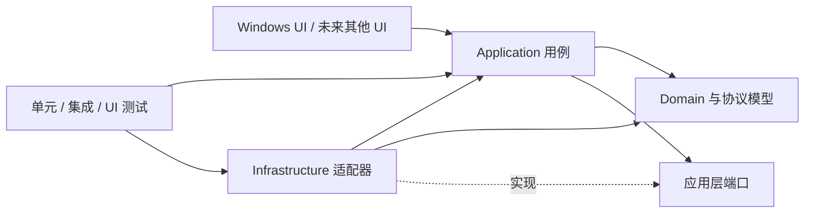

# PortHarbor 技术方案

版本：0.1.0 基线  
状态：规划稿  
范围：工程结构、诊断能力、扩展方式、平台与架构迁移

## 1. 目标与原则

PortHarbor 当前是 Windows 桌面连接工作台，提供 SSH、Telnet、RDP、FTP、SFTP、串口和本地 Shell，并包含会话管理、文件传输和基础 ANSI/VT 终端。方案以现有产品为起点，先改善可维护性和可诊断性，再为替换 UI、存储和操作系统实现留出边界。

设计原则：

1. Windows 继续作为当前正式支持平台；跨平台准备不等于提前承诺各平台功能完全一致。
2. 通过依赖方向和小型接口隔离变化，不为尚不存在的第三方扩展场景建立插件系统。
3. 先把领域逻辑、协议状态机和数据契约从 UI/操作系统中分离，再考虑替换技术栈。
4. 每个阶段都保持可构建、可测试、可回退；迁移以适配器和兼容性测试逐步完成。
5. 可诊断性和安全性属于功能要求：错误应可定位，日志不得泄露凭据、私钥或会话敏感内容。

## 2. 当前基线

| 领域 | 当前情况 | 对规划的影响 |
| --- | --- | --- |
| 桌面 UI | 单个 `net8.0-windows` WinForms 项目；`MainForm` 创建连接视图、连接对象并负责导航 | 保留 WinForms 作为当前壳；将连接生命周期和用例编排移出窗体 |
| 会话与存储 | `Session`、`AppData`、JSON 序列化、校验、备份、导入导出都在 `Models.cs`；配置 schema 版本为 1 | 先稳定版本化的数据契约，再调整存储实现 |
| 终端会话 | `TerminalConnection` 同时处理 SSH、Telnet、串口、Shell、I/O 队列、取消和资源释放 | 按协议拆成连接适配器，统一终端会话接口和错误模型 |
| 文件传输 | `FileConnection` 同时包装 FTP/SFTP，并提供复制、覆盖、临时文件等策略；`FileView` 管理 UI 任务 | 把协议适配、传输用例、UI 进度/取消分开 |
| 终端显示 | `TerminalScreen` 解析终端状态，`TerminalView` 绘制 WinForms 控件 | 把解析器保持为可独立测试的组件；渲染层通过屏幕状态/事件消费它 |
| Windows 边界 | `SecretProtection` 调用 DPAPI；`ConPty` 调用 Win32；RDP 通过 `mstsc.exe` 启动 | 明确 `ISecretProtector`、`ILocalShell`、`IRemoteDesktopLauncher` 平台服务 |
| 依赖与构建 | SSH.NET、FluentFTP、System.IO.Ports；锁定 NuGet 依赖；`build.ps1` 恢复、构建、运行检查并生成两种 x64 ZIP | 保留锁文件；CI 与本地脚本调用同一组可复现命令；发布目录使用暂存后提交 |
| 测试 | `PortHarbor.Checks` 是自定义检查程序；协议集成测试使用本机 Python FTP/SSH 服务；有 WinForms/ConPTY 检查 | 将快速单元测试、Windows 系统集成测试和协议端到端测试分层 |
| 工程自动化 | 仓库暂时没有 CI 工作流或正式解决方案分层 | 先补最小 CI 与架构说明，避免先做大规模目录重排 |

基线证据来自 [README](../README.md)、[VERIFICATION](../VERIFICATION.md)、[PortHarbor.csproj](../src/PortHarbor/PortHarbor.csproj)、[build.ps1](../build.ps1)、`Models.cs`、`MainForm.cs`、`TerminalConnection.cs`、`FileConnection.cs`、`TerminalScreen.cs`、`TerminalView.cs`、`ConPty.cs` 和 `SecretProtection.cs`。这些文件和当前实现是规划依据；方案不假设尚未实现的模块已经存在。

## 3. 目标依赖结构

依赖只朝向较稳定的领域和用例；UI 与基础设施都实现应用层定义的边界，不互相引用。



建议逐步形成以下项目边界；不需要在第一阶段一次建齐：

```text
src/
  PortHarbor.Domain/             会话、协议配置、校验、传输状态和无 UI 的终端模型
  PortHarbor.Application/        创建/编辑/连接/断开/导入导出/传输等用例和端口
  PortHarbor.Infrastructure/     JSON、SSH.NET、FluentFTP、串口和日志实现
  PortHarbor.Platform.Windows/   DPAPI、ConPTY、mstsc、Windows 文件选择器等实现
  PortHarbor.App.Windows/        WinForms 组合根、窗体、控件和 UI 线程适配
tests/
  PortHarbor.UnitTests/          不启动窗体、不访问外网的快速测试
  PortHarbor.IntegrationTests/   loopback 协议和存储适配测试
  PortHarbor.WindowsChecks/       WinForms、DPAPI、ConPTY 等 Windows 专属检查
```

依赖规则：Domain 不引用 WinForms、平台 P/Invoke、存储实现或协议厂商库；Application 只依赖 Domain 和端口；平台及协议适配器依赖端口并返回统一结果；UI 不直接构造协议客户端或操作配置文件。组合根负责把实现装配起来。将来换 UI 时保留 Domain/Application/协议规则；换操作系统时替换 Windows 平台项目，并逐项评估功能能力。

## 4. 核心边界和契约

### 4.1 会话与协议配置

- 把当前包含全部协议字段的 `Session` 逐步拆为公共会话元数据和按协议区分的配置。协议配置使用显式类型或判别联合，避免 FTP 的 TLS 字段、Shell 的工作目录等无关字段散落在同一对象。
- 在 UI 和持久化入口进行输入校验；领域模型提供无控件依赖的规则和清晰错误。协议端口、主机名、串口参数、RDP 地址等规则必须有边界测试。
- 为数据契约保留 `SchemaVersion`，用有序迁移 `v1 -> v2 -> ...` 升级配置；迁移失败时保留原文件并报告旧版/新版路径、版本和修复建议。导入导出使用单独 DTO，默认不包含密码和 SSH 主机信任记录。
- 保持已发布用户数据兼容。改字段名、协议编码或凭据格式前，先增加迁移测试和旧样本 fixture；不得把当前的用户级 DPAPI 密文当成可移植凭据。

### 4.2 连接端口

按能力定义窄接口，而不是一个含所有协议可选方法的万能连接接口：

- `ITerminalConnector`：按终端协议创建 `ITerminalSession`，提供 `ConnectAsync`、`ReadAsync`、`WriteAsync`、`ResizeAsync` 和 `CloseAsync`。
- `IFileTransferClient`：列目录、上传、下载、创建目录、重命名和删除；进度和取消使用标准回调/令牌。
- `IRemoteDesktopLauncher`：接受经校验的 RDP 选项并返回启动结果；不把 RDP 窗口生命周期伪装成嵌入式会话。
- `ISerialPortProvider`、`ILocalShellLauncher`：暴露平台能力、设备列表和启动/错误信息。
- `IHostKeyTrustStore`：执行 SSH 首次信任、已知密钥匹配和变更拒绝。确认 UI 由 Application 请求，UI 决定如何呈现。

接口只表达本产品需要的能力。SSH 和 SFTP 可以共享主机身份验证实现，但不必共享不同的终端/文件操作模型。每个网络 I/O 都应接受取消令牌和连接/操作超时；对不支持可中断取消的第三方 API，适配器必须说明行为并通过关闭底层资源解除阻塞。

### 4.3 平台服务

- `ISecretProtector`：保护/解密用户机密；Windows 初始实现使用 DPAPI。跨设备同步需要另行设计密钥管理和用户授权，不得通过简单换成固定应用密钥实现。
- `ILocalShellLauncher`：Windows 使用 ConPTY；其他平台可选其原生 PTY 实现。会话 Shell 运行的是本机进程，必须在 UI 中清楚标识并受用户授权。
- `IRemoteDesktopLauncher`：Windows 可使用 mstsc；其他平台若无等价系统客户端则显示能力不支持或提供明确配置的外部客户端。
- `IPlatformCapabilities`：报告可用能力及原因，例如 DPAPI、串口、PTY、RDP 外部客户端；UI 据此禁用或解释不可用功能。
- `IAppDataPaths`：提供配置、缓存、日志和临时文件目录。路径策略和权限在各平台实现，不让业务代码直接依赖 `LocalApplicationData`、`explorer.exe` 或平台目录格式。

平台能力不是二元的“可移植/不可移植”。每项功能应记录支持状态、降级状态和验证平台。文件会话可以跨平台迁移，DPAPI 密码密文、Windows Shell 命令和 mstsc 参数则不能假设可迁移。

## 5. 工程规范

### 代码和模块

- 保持 Nullable 开启；启用统一格式化、编译器警告和 .NET 分析器基线。新警告需在提交中解决或说明豁免，不随意关闭全局规则。
- 一个类型只承担一个主要变化原因；窗体负责呈现和用户交互，不负责协议握手、JSON 迁移或重试策略。
- 异步 I/O 使用 `Async` 命名、`CancellationToken` 和显式超时；避免 `.Result`、同步网络调用和吞异常。UI 控件更新必须经 UI 调度器完成。
- 资源实现 `IDisposable`/`IAsyncDisposable`，连接关闭应幂等；生命周期测试覆盖连接失败、取消、远端断开、关闭标签和应用退出。
- 协议实现保持厂商库封装在 Infrastructure。领域层不暴露 SSH.NET、FluentFTP、WinForms 控件或 `SafeHandle` 类型。
- 新的跨层决策记录在 `docs/adr/NNNN-short-title.md`，写明背景、选项、决策、影响和复审条件。需要新增依赖时说明它解决的问题、维护风险、许可和替代方案。

### 数据、安全和发布

- JSON 配置保存继续采用临时文件、冲刷、原子替换和备份；并发写入需有明确单实例策略，不能把进程内锁误当跨进程锁。
- 日志采用结构化字段：`operationId`、`sessionId`、`protocol`、`phase`、`durationMs`、`result`、`errorCode`。不记录密码、私钥、密文、完整连接字符串、终端内容或文件数据；主机/IP 采用用户可配置脱敏。
- 给用户显示简短错误和可执行建议；日志记录异常类型、阶段和内部堆栈。异常分类至少包括配置/校验、认证、主机身份、DNS/连接、协议、权限、取消、超时、本机平台能力和未知错误。
- 网络操作设置连接与读写超时；文件传输报告方向、字节数、临时文件/恢复状态。重试必须限定在明确幂等的操作，不能自动重放 Shell 命令或不确定是否完成的远端写入。
- NuGet 继续使用锁文件；升级依赖需运行单元、协议集成和安全相关测试并更新第三方许可清单。CI 使用无凭据的本地 fixture，不连接真实用户设备。
- 发布在临时 staging 目录完成构建和冒烟测试，成功后才替换最终 ZIP；失败时保留上一版产物。发布记录包含版本、提交号、SDK/runtime、目标 RID、依赖锁和验证摘要。

## 6. 易于排查的运行诊断

建立统一的连接生命周期状态：`Created -> Connecting -> Connected -> Closing -> Closed`，失败时附带稳定 `ErrorCode`、阶段、可重试性和安全的用户提示。禁止只把任意异常的 `Message` 直接当成诊断协议。

每次连接生成 `operationId`，并贯穿应用用例、协议适配器、文件传输和 UI 状态。终端输出与诊断日志分开：默认不开启会话录制；用户主动打开诊断包时，仅收集版本、平台、错误码、阶段、时长、超时参数和脱敏配置摘要，发送前提供预览。

最小排查流程应能回答：

1. 当前版本、提交、运行时和平台能力是什么？
2. 操作停在校验、解析、TCP、认证、主机信任、PTY、目录读取还是文件替换哪个阶段？
3. 是本机能力缺失、远端拒绝、用户取消、超时，还是程序内部错误？
4. 若连接成功但无输出，字节是否收到、解码字符数是否变化、终端解析状态是否变化？默认只记录计数，不记录终端内容。
5. 文件任务失败后，目标文件、远端 `.part`/`.bak` 和最后已确认字节数分别是什么？

初始实现可用内置 `ILogger` 抽象写轮转文件；日志目录、保留时间和脱敏规则配置化。不要先引入在线遥测。诊断包通过本地导出，用户审阅后自行决定是否分享。

## 7. 测试与 CI

### 测试层级

| 层级 | 覆盖内容 | 环境要求 | 运行频率 |
| --- | --- | --- | --- |
| Domain 单元测试 | 会话校验、端口默认值、数据迁移、终端状态机、Telnet 分片/编码、错误分类 | 不启动 UI，不需要网络 | 每次提交 |
| Application 测试 | 连接状态转换、取消、导入导出、主机信任决策、重试策略 | 依赖替身/假适配器 | 每次提交 |
| Infrastructure 集成测试 | SSH/SFTP/FTP/Telnet loopback、JSON 原子替换、凭据适配 | 本机服务；Windows 专属凭据测试在 Windows Runner | PR 和夜间任务 |
| Windows UI/系统测试 | WinForms 渲染、ConPTY 输入输出、DPAPI、RDP 配置生成 | Windows x64 | PR 冒烟及发布 |
| 发布冒烟 | 解压 portable/framework ZIP，验证入口、依赖、许可和启动/退出 | 干净 Windows 虚拟机 | 发布候选 |

- 快速测试和系统集成测试使用不同项目/标签，测试失败应返回非零退出码并输出机器可读 JSON/JUnit 报告。
- 为当前 `PortHarbor.Checks` 的自定义检查建立清单，将纯逻辑逐步迁入标准测试框架；Windows UI/ConPTY 检查继续保留为单独入口。
- 固定本地测试账号、随机临时目录和 loopback 绑定；每个测试用例负责清理进程、端口、临时文件。测试不能使用生产配置目录。
- 加入 Windows CI：格式检查、锁定依赖恢复、Release build、快速测试和现有 loopback 集成。等共享 Core 可在其他 OS 编译后，再增加 Linux/macOS 编译与核心测试矩阵，不把尚未支持的 UI/串口/RDP 项目强行放入矩阵。
- 失败产物只保留脱敏日志、报告和必要的屏幕截图；不要上传凭据、用户配置或终端输出。

## 8. 分阶段实施

### 阶段 0：建立工程基线

- 把现有验证拆为快速检查、协议集成、Windows UI/ConPTY 冒烟三类，并统一命令和结果格式。
- 加入 Windows CI、格式检查、依赖锁验证和发布冒烟；记录当前构建、测试耗时和覆盖范围。
- 修正发布脚本为 staging 发布：新版本完整成功后再更新 artifacts；保留上一个有效产物。
- 增加本文档和 ADR 模板。

**完成条件：**干净 checkout 可按文档复现 build/test；PR 有自动结果；失败时能看到稳定测试名和机器可读报告；发布失败不删除旧 ZIP。

### 阶段 1：提高可诊断性与稳健性

- 建立 `ErrorCode`、连接阶段和 `operationId`，为 SSH/Telnet/Serial/Shell/FTP/SFTP/RDP 的失败路径统一呈现。
- 将同步网络路径改为异步；传播取消令牌、连接/读写超时和进度。
- 为 UI 事件、后台任务、Dispose/关闭和错误呈现建立统一服务边界；去掉空的 `catch` 或至少记录非敏感上下文。
- 扩展生命周期、断网、取消、认证失败、无效主机、目标已存在和进程退出测试。

**完成条件：**每个连接失败都能定位操作阶段和错误类别；关闭页面能及时解除后台 I/O；没有凭据或终端文本进入日志。

### 阶段 2：从单体中抽出稳定内核

- 新建 Domain 项目，迁入 `Session`/协议配置校验、Telnet codec、终端状态模型及不依赖 WinForms 的纯逻辑。
- 新建 Application 项目，迁入会话管理、连接编排、导入导出和文件传输用例；定义前述端口。
- 把现有 `Store` 拆成配置仓储与凭据/主机信任端口实现；JSON v1 行为保持兼容。
- 为所有数据格式建立 v1 fixture 和迁移测试；先保持当前界面和用户数据目录不变。

**完成条件：**Domain/Application 可单独构建和测试；应用项目不需要引用 WinForms；旧配置在重构前后读取结果一致。

### 阶段 3：隔离协议和 Windows 实现

- 将终端协议拆为 SSH、Telnet、串口和本地 Shell 适配器，共用终端会话契约。
- 将 FTP/SFTP 拆为文件传输适配器，公共文件传输用例负责临时文件、取消、进度和确认策略。
- 将 DPAPI、ConPTY、mstsc、Windows 路径/文件选择器移入 Windows 平台项目。
- 在 UI 组合根注册实现；通过 `IPlatformCapabilities` 呈现不可用能力。

**完成条件：**领域/用例项目没有 Win32 API 和协议厂商类型；各适配器单独可测；Windows 当前功能保持现有验收结果。

### 阶段 4：按实际需求选择新平台或新 UI

- 先选一个有实际用户需求的平台和一组目标能力，不默认一次支持所有协议。
- 评估 UI 框架、PTY、串口、凭据库、RDP 外部客户端、打包/签名和可访问性；用短期技术验证确认生命周期和终端性能。
- 建立平台能力表和差异化测试。配置迁移优先保证非秘密会话数据；Windows DPAPI 密文不静默迁移或降级。
- 以独立 platform/UI 项目实现新壳；Windows WinForms 版本继续维护，直到新壳达到功能和发布验收标准。

**完成条件：**新平台的目标功能有自动化测试、打包安装路径、数据迁移说明和回退方案；支持矩阵如实列出尚不支持功能。

## 9. 迁移与替换策略

平台替换的目标不是让所有底层 API 都“跨平台化”，而是将平台相关行为集中、可枚举、可验证。每项能力按 `Native`、`ExternalTool`、`PortableLibrary`、`Unsupported` 标注实现类型和测试情况。

| 变化 | 稳定部分 | 需要替换/迁移的部分 |
| --- | --- | --- |
| WinForms 换 UI | Domain、Application 用例、协议适配器、数据契约 | `PortHarbor.App.Windows`、控件绑定、对话框、剪贴板和 UI 调度器 |
| Windows 换 Linux/macOS | 会话 DTO、连接协议策略、文件传输规则、终端模型 | DPAPI、ConPTY、本机 Shell、串口设备枚举、RDP 启动、目录/打包、平台测试 |
| JSON 换 SQLite/其他存储 | Domain 对象、Application 仓储接口、schema 迁移语义 | 仓储实现、备份/恢复、并发写和升级工具 |
| 协议库替换 | PortHarbor 的协议接口、错误/能力契约、协议验收测试 | 单一厂商适配器、许可/依赖锁和互操作性验证 |
| 内嵌终端换成熟终端引擎 | 终端会话字节流、输入/resize 端口、应用状态 | ANSI/VT parser、渲染器和终端兼容性套件；保留对现有行为的回归样例 |

每次替换遵循“旧实现仍可运行 -> 新实现并行通过契约测试 -> 迁移用户数据 -> 切换默认 -> 保留回退窗口 -> 删除旧实现”的顺序。数据迁移提供 dry-run 摘要和备份，写入完成后验证记录数/关键字段；涉及密钥时必须说明其可移植性和用户重认证要求。

## 10. 当前不做的事情

- 暂不引入微服务、远程后端、插件市场、自动更新或在线遥测。
- 暂不为了假想的跨平台目标重写 WinForms UI。
- 暂不把 RDP、DPAPI 或 Windows 本机 Shell 包装成虚假的通用抽象；接口必须承认能力差异。
- 暂不通过大量通用工厂、反射注册或动态协议加载增加调试难度。
- 暂不把配置/日志/终端内容上传到远端服务。

## 11. 风险与跟踪指标

主要风险是分层抽取期间引入行为回归、旧用户配置迁移错误、后台任务关闭不完整、平台接口过宽，以及为可移植性过度抽象。通过每阶段单独合并、旧配置 fixture、连接契约测试、幂等关闭测试和平台能力表控制风险。

每个发布周期记录以下指标：干净构建成功率、快速测试/集成测试耗时、各协议契约测试结果、连接失败分类覆盖、未处理异常数、依赖升级延迟、配置迁移成功/失败数（仅统计、不上传用户数据）、发布冒烟结果。指标用于工程改进，不用于采集用户连接行为。

## 12. 建议的近期顺序

1. 阶段 0：Windows CI、测试分层、发布 staging 和 ADR 模板。
2. 阶段 1：统一连接错误与操作阶段，先解决排查成本最高的网络和生命周期路径。
3. 阶段 2：先抽纯领域模型、Telnet codec、终端状态模型和存储契约。
4. 阶段 3：抽取平台服务和协议适配器，确保 Windows 功能与现有数据兼容。
5. 阶段 4：只有在目标用户、交付平台和能力清单明确后，选择新 UI 或新操作系统进行验证。

这一路径先降低当前开发和故障处理成本，同时使平台迁移成为替换明确组件的工作，而不是重写整个产品。
