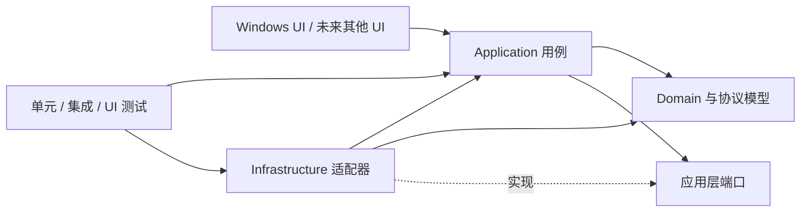

# PortHarbor 技术方案

版本：0.1.0 基线
状态：实施中（各阶段进度见第 8 节）
范围：工程结构、诊断能力、扩展方式、平台与架构迁移

## 文档分工与维护

| 文档 | 维护内容 | 更新时机 |
| --- | --- | --- |
| [文档入口](README.md) | GitHub 阅读顺序、当前快照、ADR 索引和上传前检查 | 文档结构或上传注意事项变化时 |
| 本文档 | 总体架构、路线图、阶段状态及验收条件；第 8 节是当前进度的统一入口 | 任务或阶段完成、计划调整时 |
| [开发日志](DEVELOPMENT-LOG.md) | 每次开发的范围、修改文件、验证结果、遗留问题和当时的下一步 | 每次开发结束时追加，保留历史记录 |
| [文件传输约定](FILE-TRANSFER.md) | 文件传输模块当前的接口、资源所有权、取消和覆盖语义及扩展规则 | 模块契约或实现边界变化时 |
| [终端会话约定](TERMINAL-SESSIONS.md) | 终端端口、启动/关闭所有权、输入顺序及适配器中止语义 | 终端契约或生命周期变化时 |

[README](../README.md) 负责功能介绍、运行、构建与验证命令。模块文档链接到本方案查看进度，不另行维护路线图；开发日志中的“下一步”是当时的记录，当前安排以本文档为准。历史验证结果不代表本次重新执行过检查。

## 1. 目标与原则

PortHarbor 当前是 Windows 桌面连接工作台，提供 SSH、Telnet、RDP、FTP、SFTP、串口和本地 Shell，并包含会话管理、文件传输和基础 ANSI/VT 终端。方案以现有产品为起点，先改善可维护性和可诊断性，再为替换 UI、存储和操作系统实现留出边界。

设计原则：

1. Windows 继续作为当前正式支持平台；跨平台准备不等于提前承诺各平台功能完全一致。
2. 通过依赖方向和小型接口隔离变化，不为尚不存在的第三方扩展场景建立插件系统。
3. 先把领域逻辑、协议状态机和数据契约从 UI/操作系统中分离，再考虑替换技术栈。
4. 每个阶段都保持可构建、可测试、可回退；迁移以适配器和兼容性测试逐步完成。
5. 可诊断性和安全性属于功能要求：错误应可定位，日志不得泄露凭据、私钥或会话敏感内容。

## 2. 当前基线

| 领域 | 当前情况 | 对规划的影响 |
| --- | --- | --- |
| 桌面 UI | `PortHarbor` 是 `net8.0-windows` WinForms 组合根；`MainForm` 负责导航、视图和平台服务装配 | 保留 WinForms 作为当前壳；连接生命周期、存储和平台调用通过 Application/平台端口进入 |
| 会话与存储 | Application 提供会话、配置及导入导出策略；Infrastructure 负责 JSON/INI、schema v1/v2、备份、迁移和主机信任 | 保持 v1/v2 与安装/便携配置兼容，导入通过最新快照单次保存和失败回滚 |
| 终端会话 | Application 的 `TerminalConnection` 管理统一终端生命周期、I/O 队列、取消和资源释放；SSH/Telnet 在 Infrastructure，Shell/Serial/ConPTY 在 Windows 平台 | 继续完善剩余协议实机验证和平台边界 |
| 文件传输 | Application 的 `FileConnection` 管理取消、超时、临时文件和覆盖策略；FTP/SFTP 由 Infrastructure 适配 | 当前契约见 [文件传输约定](FILE-TRANSFER.md)，实现保持异步操作和失败清理 |
| 终端显示 | Domain 的 `TerminalScreen` 保存解析状态，WinForms `TerminalView` 负责绘制 | 保持解析器无 UI 依赖，后续再评估成熟终端引擎 |
| Windows 边界 | DPAPI、mstsc、能力、路径和 ConPTY 位于 Windows 平台项目；文件对话框位于独立的 Windows Forms 平台项目 | 保留现有用户交互与数据兼容，Application 文件选择端口不依赖 UI |
| 依赖与构建 | SSH.NET、FluentFTP、System.IO.Ports；锁定 NuGet 依赖；默认生成不含 .NET 环境的框架依赖 x64 ZIP，`-IncludeRuntime` 可选生成自包含包 | 保留锁文件；CI 与本地脚本调用同一组可复现命令；发布目录使用暂存后提交 |
| 测试 | Application 检查、核心 Windows 检查、WinForms/ConPTY 检查和本机 Python 协议回环均由 `PortHarbor.Checks` 分层入口执行 | 继续保持快速检查、Windows 系统检查、协议端到端和发布冒烟分层 |
| 工程自动化 | 已有 Windows CI 工作流和分层检查入口；WinForms 界面、应用用例和平台/协议适配器已分项目 | 继续补齐工程基线验收及未完成的业务边界 |

当前依据来自 [README](../README.md)、[开发日志](DEVELOPMENT-LOG.md)、[PortHarbor.csproj](../src/PortHarbor/PortHarbor.csproj)、[build.ps1](../build.ps1)、Domain/Application/Infrastructure/Platform.Windows 项目及 `MainForm.cs`。早期单体文件名只保留在历史日志中，不作为当前源码路径；方案中的完成状态以当前工作区和验证报告为准。

### UI 与双版本配置增量（2026-10-23）

- [x] 终端使用已安装等宽字体回退，字体及 DPI 变化重算字符格。
- [x] 分类树增加文件夹、终端、文件传输和 RDP 图标，支持多层嵌套与搜索保留父路径。
- [x] 菜单分为文件、会话、窗口、设置和帮助，下拉管理操作。
- [x] 安装版用户目录 JSON / 便携版程序旁 INI；便携密码库由主密码保护，安装版保留 DPAPI。
- [x] 构建同时输出两版目录包，包含运行环境为独立选项。
- [ ] 正式安装向导、升级与卸载流程（后续发行阶段）。

本增量完成日期：2026-10-23；提交：当前工作区，待提交。

终端交互增量：主密码命名、跳过解锁、滚动条、可选左键复制、可选右键粘贴、字体和配色菜单已实现；设置持久化与 SSH 交互式认证仍未完成。正式安装程序不计为已完成。本增量的当前实现分布在 `src/PortHarbor/MainForm.cs`、`SessionEditor.cs`、Domain/Application/Infrastructure 和 Windows 平台项目中；历史单体文件名只保留在开发日志中。基线表中此前仅 JSON、DPAPI 和单一框架包的描述以本增量为准；阶段 0–4 的整体状态仍按各自验收条件判断。

## 3. 目标依赖结构

依赖只朝向较稳定的领域和用例；UI 与基础设施都实现应用层定义的边界，不互相引用。



建议逐步形成以下项目边界；不需要在第一阶段一次建齐：

```text
src/
  PortHarbor.Domain/             会话、协议配置、校验、传输状态和无 UI 的终端模型
  PortHarbor.Application/        创建/编辑/连接/断开/导入导出/传输等用例和端口
  PortHarbor.Infrastructure/     JSON、SSH.NET、FluentFTP、串口和日志实现
  PortHarbor.Platform.Windows/   DPAPI、ConPTY、mstsc、能力与路径等实现
  PortHarbor.Platform.Windows.Forms/ Windows Forms 文件选择器适配
  PortHarbor.App.Windows/        WinForms 组合根、窗体、控件和 UI 线程适配
tests/
  PortHarbor.UnitTests/          不启动窗体、不访问外网的快速测试
  PortHarbor.IntegrationTests/   loopback 协议和存储适配测试
  PortHarbor.WindowsChecks/       WinForms、DPAPI、ConPTY 等 Windows 专属检查
```

依赖规则：Domain 不引用 WinForms、平台 P/Invoke、存储实现或协议厂商库；Application 只依赖 Domain 和端口；平台及协议适配器依赖端口并返回统一结果；UI 不直接构造协议客户端或操作配置文件。组合根负责把实现装配起来。将来换 UI 时保留 Domain/Application/协议规则；换操作系统时替换 Windows 平台项目，并逐项评估功能能力。

## 4. 核心边界和契约

### 4.1 会话与协议配置

- 把当前包含全部协议字段的 `Session` 逐步拆为公共会话元数据和按协议区分的配置。协议配置使用显式类型或判别联合，避免 FTP 的 TLS 字段、Shell 的工作目录等无关字段散落在同一对象。
- 在 UI 和持久化入口进行输入校验；领域模型提供无控件依赖的规则和清晰错误。协议端口、主机名、串口参数、RDP 地址等规则必须有边界测试。
- 为数据契约保留 `SchemaVersion`，用有序迁移 `v1 -> v2 -> ...` 升级配置；迁移失败时保留原文件并报告旧版/新版路径、版本和修复建议。导入导出使用单独 DTO，默认不包含密码和 SSH 主机信任记录。当前规则与存储事务见[会话配置导入导出约定](CONFIGURATION-TRANSFER.md)及 [ADR 0007](adr/0007-configuration-transfer-policy.md)。
- 保持已发布用户数据兼容。改字段名、协议编码或凭据格式前，先增加迁移测试和旧样本 fixture；不得把当前的用户级 DPAPI 密文当成可移植凭据。

### 4.2 连接端口

按能力定义窄接口，而不是一个含所有协议可选方法的万能连接接口：

- `ITerminalConnector`：按终端协议创建 `ITerminalSession`，提供 `ConnectAsync`、`ReadAsync`、`WriteAsync`、`ResizeAsync` 和 `CloseAsync`。
- `IFileTransferClient`：列目录、上传、下载、创建目录、重命名和删除；进度和取消使用标准回调/令牌。
- `IRemoteDesktopLauncher`：接受经校验的 RDP 选项并返回启动结果；不把 RDP 窗口生命周期伪装成嵌入式会话。
- `ISerialPortProvider`、`ILocalShellLauncher`：暴露平台能力、设备列表和启动/错误信息。
- `IHostKeyTrust`：执行 SSH 首次信任、已知密钥匹配和变更拒绝。确认回调由 UI 注入，存储适配器只保存用户确认的指纹。

接口只表达本产品需要的能力。SSH 和 SFTP 可以共享主机身份验证实现，但不必共享不同的终端/文件操作模型。每个网络 I/O 都应接受取消令牌和连接/操作超时；对不支持可中断取消的第三方 API，适配器必须说明行为并通过关闭底层资源解除阻塞。

### 4.3 平台服务

- `ISecretProtector`：保护/解密用户机密；Windows 初始实现使用 DPAPI。跨设备同步需要另行设计密钥管理和用户授权，不得通过简单换成固定应用密钥实现。
- `ILocalShellLauncher`：Windows 使用 ConPTY；其他平台可选其原生 PTY 实现。会话 Shell 运行的是本机进程，必须在 UI 中清楚标识并受用户授权。
- `IRemoteDesktopLauncher`：Windows 可使用 mstsc；其他平台若无等价系统客户端则显示能力不支持或提供明确配置的外部客户端。
- `IPlatformCapabilities`：报告可用能力及原因，例如 DPAPI、串口、PTY、RDP 外部客户端；UI 据此禁用或解释不可用功能。
- `IAppDataPaths`：提供配置、缓存、日志和临时文件目录。路径策略和权限在各平台实现，不让业务代码直接依赖 `LocalApplicationData`、`explorer.exe` 或平台目录格式。
- `IFilePicker`：同步单文件打开/保存，传递过滤器、建议文件名与选中路径，取消返回 `null`；Windows Forms 适配器持有模态 owner，业务端口不暴露窗口类型。

平台能力不是二元的“可移植/不可移植”。每项功能应记录支持状态、降级状态和验证平台。文件会话可以跨平台迁移，DPAPI 密码密文、Windows Shell 命令和 mstsc 参数则不能假设可迁移。

## 5. 工程规范

### 代码和模块

- 保持 Nullable 开启；启用统一格式化、编译器警告和 .NET 分析器基线。新警告需在提交中解决或说明豁免，不随意关闭全局规则。
- 一个类型只承担一个主要变化原因；窗体负责呈现和用户交互，不负责协议握手、JSON 迁移或重试策略。
- 异步 I/O 使用 `Async` 命名、`CancellationToken` 和显式超时；避免 `.Result`、同步网络调用和吞异常。UI 控件更新必须经 UI 调度器完成。
- 资源实现 `IDisposable`/`IAsyncDisposable`，连接关闭应幂等；生命周期测试覆盖连接失败、取消、远端断开、关闭标签和应用退出。
- 协议实现保持厂商库封装在 Infrastructure。领域层不暴露 SSH.NET、FluentFTP、WinForms 控件或 `SafeHandle` 类型。
- 新的跨层决策记录在 `docs/adr/NNNN-short-title.md`，写明背景、选项、决策、影响和复审条件。需要新增依赖时说明它解决的问题、维护风险、许可和替代方案。

### 数据、安全和发布

- JSON 配置保存继续采用临时文件、冲刷、原子替换和备份；并发写入需有明确单实例策略，不能把进程内锁误当跨进程锁。
- 日志采用结构化字段：`operationId`、`sessionId`、`protocol`、`phase`、`durationMs`、`result`、`errorCode`。不记录密码、私钥、密文、完整连接字符串、终端内容或文件数据；主机/IP 采用用户可配置脱敏。
- 给用户显示简短错误和可执行建议；日志记录异常类型、阶段和内部堆栈。异常分类至少包括配置/校验、认证、主机身份、DNS/连接、协议、权限、取消、超时、本机平台能力和未知错误。
- 网络操作设置连接与读写超时；文件传输报告方向、字节数、临时文件/恢复状态。重试必须限定在明确幂等的操作，不能自动重放 Shell 命令或不确定是否完成的远端写入。
- NuGet 继续使用锁文件；升级依赖需运行单元、协议集成和安全相关测试并更新第三方许可清单。CI 使用无凭据的本地 fixture，不连接真实用户设备。
- 发布在临时 staging 目录完成构建和冒烟测试，成功后才替换最终 ZIP；失败时保留上一版产物。发布记录包含版本、提交号、SDK/runtime、目标 RID、依赖锁和验证摘要。

## 6. 易于排查的运行诊断

建立统一的连接生命周期状态：`Created -> Connecting -> Connected -> Closing -> Closed`，失败时附带稳定 `ErrorCode`、阶段、可重试性和安全的用户提示。禁止只把任意异常的 `Message` 直接当成诊断协议。

每次连接生成 `operationId`，并贯穿应用用例、协议适配器、文件传输和 UI 状态。终端输出与诊断日志分开：默认不开启会话录制；用户主动打开诊断包时，仅收集版本、平台、错误码、阶段、时长、超时参数和脱敏配置摘要，发送前提供预览。

最小排查流程应能回答：

1. 当前版本、提交、运行时和平台能力是什么？
2. 操作停在校验、解析、TCP、认证、主机信任、PTY、目录读取还是文件替换哪个阶段？
3. 是本机能力缺失、远端拒绝、用户取消、超时，还是程序内部错误？
4. 若连接成功但无输出，字节是否收到、解码字符数是否变化、终端解析状态是否变化？默认只记录计数，不记录终端内容。
5. 文件任务失败后，目标文件、远端 `.part`/`.bak` 和最后已确认字节数分别是什么？

初始实现可用内置 `ILogger` 抽象写轮转文件；日志目录、保留时间和脱敏规则配置化。不要先引入在线遥测。诊断包通过本地导出，用户审阅后自行决定是否分享。

## 7. 测试与 CI

### 测试层级

| 层级 | 覆盖内容 | 环境要求 | 运行频率 |
| --- | --- | --- | --- |
| Domain 单元测试 | 会话校验、端口默认值、数据迁移、终端状态机、Telnet 分片/编码、错误分类 | 不启动 UI，不需要网络 | 每次提交 |
| Application 测试 | 连接状态转换、取消、导入导出、主机信任决策、重试策略 | 依赖替身/假适配器 | 每次提交 |
| Infrastructure 集成测试 | SSH/SFTP/FTP/Telnet loopback、JSON 原子替换、凭据适配 | 本机服务；Windows 专属凭据测试在 Windows Runner | PR 和夜间任务 |
| Windows UI/系统测试 | WinForms 渲染、ConPTY 输入输出、DPAPI、RDP 配置生成 | Windows x64 | PR 冒烟及发布 |
| 发布冒烟 | 解压 portable/framework ZIP，验证入口、依赖、许可和启动/退出 | 干净 Windows 虚拟机 | 发布候选 |

- 快速测试和系统集成测试使用不同项目/标签，测试失败应返回非零退出码并输出机器可读 JSON/JUnit 报告。
- 为当前 `PortHarbor.Checks` 的自定义检查建立清单，将纯逻辑逐步迁入标准测试框架；Windows UI/ConPTY 检查继续保留为单独入口。
- 固定本地测试账号、随机临时目录和 loopback 绑定；每个测试用例负责清理进程、端口、临时文件。测试不能使用生产配置目录。
- 加入 Windows CI：格式检查、锁定依赖恢复、Release build、快速测试和现有 loopback 集成。等共享 Core 可在其他 OS 编译后，再增加 Linux/macOS 编译与核心测试矩阵，不把尚未支持的 UI/串口/RDP 项目强行放入矩阵。
- 失败产物只保留脱敏日志、报告和必要的屏幕截图；不要上传凭据、用户配置或终端输出。

## 8. 分阶段实施

进度核对日期：2026-10-27。依据当前源码、构建脚本、CI 工作流及开发日志中的验证记录。

| 阶段 | 状态 | 当前结论 |
| --- | --- | --- |
| 0：工程基线 | 进行中 | Windows 本机独立干净 checkout、锁定恢复、完整扩展检查及耗时基线已验收；发布故障注入与回滚范围仍待补齐 |
| 1：诊断与稳健性 | 进行中 | 文件传输已异步化并有取消/超时/关闭测试；其余协议诊断和后台生命周期仍待完善 |
| 2：稳定内核 | 进行中 | Domain/Application 承载会话、配置、导入导出、文件传输和终端编排；存储及网络适配器在 Infrastructure，其余纯逻辑仍待梳理 |
| 3：协议与平台隔离 | 部分提前完成 | 文件传输、SSH/Telnet 已分层；Windows 平台实现、能力、路径及文件选择端口已接入，真实设备/远程登录验收仍待完成 |
| 4：新平台或 UI | 未开始（按需求启动） | 尚未选择目标平台与能力范围 |

维护规则：`[x]` 仅表示该子任务已完成，`[ ]` 表示未完成或尚未验证。部分完成的任务应拆成可独立核验的子项。每次开发结束同步更新清单并追加开发日志；只有全部任务及完成条件均有验证依据，才将阶段标为“已完成”，填写完成日期、对应提交和开发日志链接。阶段可以交叉实施，提前完成某个子项不代表整个阶段完成。

### 阶段 0：建立工程基线

状态：进行中；完成日期：待验收；完成提交：待验收。

- [x] 将验证拆为核心、Windows、协议集成和 UI/ConPTY 入口，提供 JSON 结果报告。
- [x] 加入 Windows CI，执行恢复、Release 构建及上述检查，上传结果报告。
- [x] 使用 NuGet 依赖锁文件。
- [x] 加入自动差异空白检查及强制锁定模式恢复验证。
- [x] 将发行包启动冒烟纳入发布流程；已有 `tests/build-rollback.ps1` 验证失败后保留旧产物。
- [x] 在 Windows 本机独立干净 checkout、空构建/依赖缓存下完成锁定恢复与完整扩展基线；验收提交 `e110c4e`，共 568 项检查及四项冒烟通过。
- [ ] 补齐发布失败的故障注入范围，分别核验替换前、部分目标替换后及旧产物被占用时的回滚行为；已有替换完成后注入检查不代表这些场景均已覆盖。
- [x] 建立构建、测试耗时和覆盖范围基线；发布脚本生成 `engineering-baseline.json`，区分检查计数与尚未接入的源代码覆盖率。
- [x] 发布脚本使用 staging，成功后替换产物，失败时尝试回滚。
- [x] 增加总体技术方案。
- [x] 增加 ADR 模板。

依据：[`windows-ci.yml`](../.github/workflows/windows-ci.yml)、[`build.ps1`](../build.ps1)、[`build-rollback.ps1`](../tests/build-rollback.ps1)、[`packages.lock.json`](../src/PortHarbor/packages.lock.json)、[`ADR 模板`](adr/0000-template.md)；基线报告为 `engineering-baseline.json`，干净 checkout 的提交、环境、结果及限制见[开发日志](DEVELOPMENT-LOG.md)中“独立干净 checkout 验收及协议失败日志归档”。本次仅完成同一台 Windows 机器上的独立克隆验收，另一台机器的复现和原 Temp 克隆 FTP 550 的根因仍待确认。

**完成条件：**干净 checkout 可按文档复现 build/test；PR 有自动结果；失败时能看到稳定测试名和机器可读报告；发布失败不删除旧 ZIP。

### 阶段 1：提高可诊断性与稳健性

状态：进行中；完成日期：待验收；完成提交：待验收。

- [x] 建立稳定错误码、连接阶段、状态、可重试性和 `operationId`，接入终端及文件连接诊断。
- [x] 增加安全诊断展示器，文件视图显示阶段及错误类别。
- [x] 建立 Application 内嵌诊断消息目录，将稳定错误码/阶段与中文提示分离；无 UI 的 DiagnosticPresenter 负责组合，覆盖完整性、未知枚举/语言回退、操作编号和全协议敏感信息隔离。
- [x] 统一终端及 RDP 的诊断展示，核验 SSH、Telnet、FTP、SFTP、Shell 和 RDP 的失败路径；串口实体设备及 FTPS 仍待实机验证。
- [x] 将文件传输契约及 FTP/SFTP 适配器改为原生异步，统一取消、超时和结构化进度，移除文件视图的同步调用包装。
- [ ] 完善其他同步网络路径的异步、取消及超时处理。
- [x] 文件视图关闭标签及应用退出时取消并等待活动文件操作和传输连接释放。
- [x] 终端通过统一会话端口提供可等待关闭，标签和应用退出等待启动、输入任务及资源清理。
- [ ] 为其余 UI 事件和后台任务完善统一服务边界；清理空 `catch` 或记录非敏感上下文。
- [x] 增加连接失败/关闭诊断、安全展示脱敏、文件传输取消清理与目标冲突检查。
- [x] 增加终端启动中取消、晚启动返回、阻塞写入关闭竞态，以及真实 SSH 握手/Telnet 读取阻塞取消检查。
- [x] 补齐 SSH/Telnet/FTP/SFTP 拒绝连接、FTP 错误密码、SSH 连接丢失与正常 Shell 退出、Telnet reset 与正常 EOF 的本机协议检查；修复 SSH 掉线后阻塞读取和 FTP 错误连接阶段，保留关闭清理与安全提示。
- [x] 补齐 FTP/SFTP 数据复制阶段断线的旧目标保护、下载暂存清理、原阶段诊断及关闭期限检查；下载增加已知长度和最终协议确认门禁，FTP 最终拒绝确认不得覆盖旧文件，确认等待中关闭可取消。
- [ ] 补齐覆盖提交/备份恢复期间断线、实际主机解析失败、静默断网、串口阻塞及其他进程退出等覆盖；当前 HostNotFound 分类检查不代表真实 DNS 验收。

依据：[`DiagnosticClassifier.cs`](../src/PortHarbor.Infrastructure/DiagnosticClassifier.cs)、[`DiagnosticPresenter.cs`](../src/PortHarbor.Application/DiagnosticPresenter.cs)、[`消息目录`](../src/PortHarbor.Application/DiagnosticMessageCatalog.cs)、[`资源`](../src/PortHarbor.Application/Resources/DiagnosticMessages.resx)、[`ConnectionStatusLabel.cs`](../src/PortHarbor/ConnectionStatusLabel.cs)、[诊断消息约定](DIAGNOSTICS.md)、[ADR 0008](adr/0008-diagnostic-message-catalog.md)、终端/RDP/文件连接实现及[开发日志](DEVELOPMENT-LOG.md)。目录回归报告位于 ignored `artifacts/diagnostic-messages/`；其余未勾选任务仍需单独验收。

**完成条件：**每个连接失败都能定位操作阶段和错误类别；关闭页面能及时解除后台 I/O；没有凭据或终端文本进入日志。

### 阶段 2：从单体中抽出稳定内核

状态：进行中；完成日期：待验收；完成提交：待验收。

- [x] 新建 Domain 项目，迁入 `Session`/协议配置校验、协议枚举、连接诊断契约和 Telnet codec；Domain 独立目标为 `net8.0`，不引用 WinForms 或协议厂商库。
- [x] 将文件传输数据记录、进度契约和 `IFileTransfer`/`IRemoteFileSystem` 端口迁入 Domain；FTP/SFTP 工厂及实现仍留在基础设施侧。
- [x] 将终端屏幕状态模型 `TerminalScreen` 和 `Cell` 迁入 Domain，保留基础颜色值类型，不依赖 WinForms 或 GDI 渲染。
- [ ] 梳理并迁移其余不依赖平台的纯逻辑。
- [x] 新建 Application 项目，迁入会话创建、编辑、删除和读取用例；定义 `ISessionRepository`，不引用 WinForms 或厂商库。
- [x] 定义配置仓储、密码库、主机信任端口及 `ConfigurationService`；界面、SSH 终端和 SFTP 适配器通过端口使用。
- [x] 将 `Store` 的 JSON/INI 格式读写、密码库及主机信任持久化拆入 `PortHarbor.Infrastructure`；适配器共享配置状态、写入锁及原子替换，项目目标 `net8.0-windows` 且不引用 WinForms。
- [x] 将 `FileConnection` 和共享超时策略迁入 Application，通过 `IRemoteFileSystem` 及错误分类回调隔离协议厂商；独立 `net8.0` 检查覆盖取消、临时文件、提交、超时及关闭竞态。
- [x] 定义 `ITerminalSession`/`ITerminalTransport`，将终端校验、连接生命周期、输入队列、UTF-8 解码、取消与关闭编排迁入 Application。
- [x] 将分类合并、新 ID 分配、导入/导出禁用密码保存和敏感字段排除迁入 Application；格式读写与最新快照下单次保存/回滚留在存储适配器，补齐真正 JSON/INI 交叉格式、并发与凭据关联检查。
- [x] 为会话 JSON v1/v2 和便携 INI 建立 fixture、迁移、凭据关联及失败回滚检查；先保持当前界面和用户数据目录不变。

验收依据：独立 Application 检查 151 项、核心检查 320 项、Windows 14 项及 UI 57 项通过，覆盖传输策略、真实 JSON/INI 交叉格式、并发合并、凭据关联与失败回滚，以及无 UI 诊断呈现、消息完整性和回退；核心含默认便携启动及末尾目录分隔符回归，发布门禁检查默认便携首次启动和重启。Release 构建报告见[开发日志](DEVELOPMENT-LOG.md)。导入导出规则与诊断呈现已进入 Application，Infrastructure 的 Windows 目标和其余纯逻辑仍待后续处理，整个阶段尚未完成。

**完成条件：**Domain/Application 可单独构建和测试；应用项目不需要引用 WinForms；旧配置在重构前后读取结果一致。

### 阶段 3：隔离协议和 Windows 实现

状态：部分提前完成；完成日期：待验收；完成提交：待验收。

- [x] 将 SSH/Telnet 终端拆为 Infrastructure 适配器，共用 Application 终端端口，移除 UI 对 SSH.NET 的直接包引用。
- [x] 建立 `PortHarbor.Platform.Windows`，分别迁入串口、本地 Shell 与 ConPTY 实现；共享流生命周期基类归入 Application，平台项目不引用 UI 或网络 Infrastructure。
- [x] 增加 `ISerialPortProvider`，通过平台实现提供串口设备与参数选项；UI 移除 System.IO.Ports 直接包引用及类型使用，保持旧配置字符串兼容。
- [x] 建立异步 `IFileTransfer`/`IRemoteFileSystem` 边界，拆分 FTP/SFTP 适配器；公共层管理超时、取消、临时文件和结构化进度，UI 保留覆盖确认。
- [x] 将文件传输用例及 FTP/SFTP 适配器迁入独立 Application/Infrastructure 项目；共享 SSH 配置与厂商错误分类位于 Infrastructure，维持异步契约和既有回归结果。
- [x] 定义 `ISecretProtector`，将 DPAPI 移入 Windows 平台项目并注入存储；保留安装版、便携版及旧凭据迁移格式，平台失败不得降级保护。
- [x] 定义 `IRemoteDesktopLauncher`，将 RDP 校验/配置/诊断迁入 Application，mstsc 与临时文件生命周期移入 Windows 平台项目。
- [x] 定义 `IAppDataPaths`，将安装/便携路径、旧 EasyConnect 迁移源和 RDP 临时目录解析移入 Windows 平台项目；存储适配器消费解析结果并拒绝配置文件越界路径。
- [x] 定义 `IFilePicker`，将会话导入导出及文件上传下载的打开/保存对话框迁入独立 `PortHarbor.Platform.Windows.Forms`；保留现有 owner、过滤器、默认文件名及取消/覆盖语义，既有平台库不增加 WinForms 依赖。
- [x] 在 UI 组合根注册 `IPlatformCapabilities` Windows 实现，编辑器禁用不可用连接但允许保存，连接入口在创建资源前显示原因并支持重新检查；帮助菜单展示包括 DPAPI 在内的能力概览。

依据：[`FileTransferContracts.cs`](../src/PortHarbor.Domain/FileTransferContracts.cs)、[`TerminalContracts.cs`](../src/PortHarbor.Application/TerminalContracts.cs)、[`平台服务端口`](../src/PortHarbor.Application/PlatformContracts.cs)、[`路径端口`](../src/PortHarbor.Application/AppDataPaths.cs)、[`文件选择端口`](../src/PortHarbor.Application/FilePicker.cs)、[`能力端口与连接策略`](../src/PortHarbor.Application/PlatformCapabilities.cs)、[`Windows 平台项目`](../src/PortHarbor.Platform.Windows/PortHarbor.Platform.Windows.csproj)、[文件传输约定](FILE-TRANSFER.md)、[终端会话约定](TERMINAL-SESSIONS.md)、[凭据与 RDP 决策](adr/0003-secret-protection-and-rdp.md)、[平台能力决策](adr/0004-platform-capabilities.md)、[路径决策](adr/0005-application-data-paths.md)、[文件选择决策](adr/0006-windows-file-picker.md)及开发日志。协议回环 26 项通过，DPAPI 迁移、RDP 清理、能力缺失/恢复、路径解析/迁移与文件选择接入已覆盖；真实 RDP 登录及串口仍需后续验收，系统文件对话框点击未纳入自动化。

**完成条件：**领域/用例项目没有 Win32 API 和协议厂商类型；各适配器单独可测；Windows 当前功能保持现有验收结果。

### 阶段 4：按实际需求选择新平台或新 UI

状态：未开始（按需求启动）；完成日期：待验收；完成提交：待验收。

- [ ] 先选一个有实际用户需求的平台和一组目标能力，不默认一次支持所有协议。
- [ ] 评估 UI 框架、PTY、串口、凭据库、RDP 外部客户端、打包/签名和可访问性；用短期技术验证确认生命周期和终端性能。
- [ ] 建立平台能力表和差异化测试。配置迁移优先保证非秘密会话数据；Windows DPAPI 密文不静默迁移或降级。
- [ ] 以独立 platform/UI 项目实现新壳；Windows WinForms 版本继续维护，直到新壳达到功能和发布验收标准。

验收依据：待需求确定后记录目标平台、能力清单、技术验证及发布验收结果。

**完成条件：**新平台的目标功能有自动化测试、打包安装路径、数据迁移说明和回退方案；支持矩阵如实列出尚不支持功能。

### 预览体验优化（2026-10-23）

状态：已完成本次实现与本机验收；完成日期：2026-10-23；对应提交：待提交（当前工作区）。本批任务独立于阶段 0–4，不表示那些阶段已完成。

- [x] 支持创建单层分类、保留空分类、编辑器选择分类及导入导出分类。
- [x] 支持双击标签标题、标签右侧 ×、中键、工具栏及快捷键关闭，并统一关闭确认。
- [x] 在现有 DPAPI 保护外增加主密码加密，支持启动解锁、修改主密码、v1 凭据迁移及失败回滚。
- [x] 默认只生成框架依赖预览包，按需使用 `-IncludeRuntime`；支持独立输出目录以避开运行中的旧程序。

验收依据：[开发日志](DEVELOPMENT-LOG.md)中“分类、标签关闭、主密码与预览打包”记录；加密及迁移决策见 [ADR 0001](adr/0001-master-password.md)。SSH 交互式认证、字体/配色设置持久化和正式安装向导仍未完成。

## 9. 迁移与替换策略

平台替换的目标不是让所有底层 API 都“跨平台化”，而是将平台相关行为集中、可枚举、可验证。每项能力按 `Native`、`ExternalTool`、`PortableLibrary`、`Unsupported` 标注实现类型和测试情况。

| 变化 | 稳定部分 | 需要替换/迁移的部分 |
| --- | --- | --- |
| WinForms 换 UI | Domain、Application 用例、协议适配器、数据契约 | `PortHarbor.App.Windows`、控件绑定、对话框、剪贴板和 UI 调度器 |
| Windows 换 Linux/macOS | 会话 DTO、连接协议策略、文件传输规则、终端模型 | DPAPI、ConPTY、本机 Shell、串口设备枚举、RDP 启动、目录/打包、平台测试 |
| JSON 换 SQLite/其他存储 | Domain 对象、Application 仓储接口、schema 迁移语义 | 仓储实现、备份/恢复、并发写和升级工具 |
| 协议库替换 | PortHarbor 的协议接口、错误/能力契约、协议验收测试 | 单一厂商适配器、许可/依赖锁和互操作性验证 |
| 内嵌终端换成熟终端引擎 | 终端会话字节流、输入/resize 端口、应用状态 | ANSI/VT parser、渲染器和终端兼容性套件；保留对现有行为的回归样例 |

每次替换遵循“旧实现仍可运行 -> 新实现并行通过契约测试 -> 迁移用户数据 -> 切换默认 -> 保留回退窗口 -> 删除旧实现”的顺序。数据迁移提供 dry-run 摘要和备份，写入完成后验证记录数/关键字段；涉及密钥时必须说明其可移植性和用户重认证要求。

## 10. 当前不做的事情

- 暂不引入微服务、远程后端、插件市场、自动更新或在线遥测。
- 暂不为了假想的跨平台目标重写 WinForms UI。
- 暂不把 RDP、DPAPI 或 Windows 本机 Shell 包装成虚假的通用抽象；接口必须承认能力差异。
- 暂不通过大量通用工厂、反射注册或动态协议加载增加调试难度。
- 暂不把配置/日志/终端内容上传到远端服务。

## 11. 风险与跟踪指标

主要风险是分层抽取期间引入行为回归、旧用户配置迁移错误、后台任务关闭不完整、平台接口过宽，以及为可移植性过度抽象。通过每阶段单独合并、旧配置 fixture、连接契约测试、幂等关闭测试和平台能力表控制风险。

每个发布周期记录以下指标：干净构建成功率、快速测试/集成测试耗时、各协议契约测试结果、连接失败分类覆盖、未处理异常数、依赖升级延迟、配置迁移成功/失败数（仅统计、不上传用户数据）、发布冒烟结果。指标用于工程改进，不用于采集用户连接行为。

## 12. 当前后续顺序

以下安排对应第 8 节任务清单，不代表新增验收项：

1. 继续补齐阶段 1 的 SFTP 覆盖提交/备份恢复期间断线、实际主机解析失败及静默断网等故障场景；拒绝连接、SSH/Telnet 终端中断、FTP/SFTP 数据复制阶段中断与 FTP 下载最终确认已纳入协议回环。更多语言资源实施前另行补入阶段 1 清单，按实际需求验收。
2. 真实串口设备、真实 RDP 登录、FTPS、私钥登录及生产服务器兼容性仍需对应环境验收；本机干净克隆通过不替代这些专项结果。
3. 补齐阶段 0 尚未验收的发布故障注入和回滚范围，具体缺口见第 8 节；原 Temp 克隆 FTP 550 如再次出现，使用保留的 fixture 日志继续定位。
4. 继续按阶段 2、3 完善其余应用端口，保持 Windows 行为及用户数据兼容。
5. 阶段 4 仅在目标用户、交付平台和能力清单明确后启动。

这一路径先降低当前开发和故障处理成本，同时使平台迁移成为替换明确组件的工作，而不是重写整个产品。


